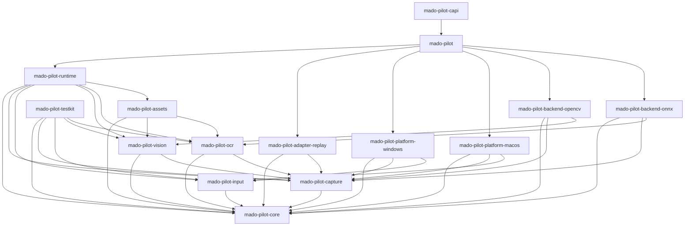
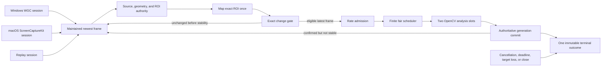

# MadoPilot architecture baseline

This document is the tracked architecture baseline and canonical source of truth
for MadoPilot's repository structure, package responsibilities, dependency
allowlist, public naming, release targets, OS support policy, and implemented
runtime contracts. Short [decision records](adr/README.md) explain consequential
architectural choices, topic guides in the [documentation index](README.md) own
feature-specific usage and verification procedures, and historical measurements
and release records stay in [evidence](evidence/),
[benchmark profiles](benchmarks/), and [release notes](releases/).

## Product definition

MadoPilot is a headless visual automation runtime for applications and agents on
Windows x64 (`x86_64-pc-windows-msvc`) and Apple Silicon macOS
(`aarch64-apple-darwin`). It discovers windows and displays, captures frame
streams, maps coordinate spaces, performs OpenCV template matching and bounded
ONNX Runtime OCR (singular and 1–16 zone grouped scans with explicit
initialization-time provider policy), waits for visual conditions through
bounded Rust template and OCR text watchers, injects input through explicit
platform capabilities, and emits structured, content-redacted diagnostics.

MadoPilot does not own a GUI, tray, editor, overlay, updater, workflow catalog,
general workflow/cron scheduler, C++ wrapper, or general scripting DSL. It
performs no implicit network access, automatic privilege escalation, or
permission prompting. See [Implementation status](#implementation-status) for the
current capability matrix and unavailable surfaces.

## Release targets

Version one targets two platforms, each verified natively rather than through
cross-compilation:

| Release target | Minimum deployment floor (`G-001`) | Verification hosts |
|---|---|---|
| `x86_64-pc-windows-msvc` | Serviced Windows 11 25H2 x64 desktop (build family `26200`); earlier versions unsupported | Current CPU OCR cohort: Core i7-12700KF, 32 GiB, Windows 11 Pro 26H2 (`26300.9550`). Historical platform qualification: Windows 11 Pro 25H2 (`26200`, native watcher UBR `9278`), SDK `10.0.26100.0`. Hosted CI: `windows-2025` |
| `aarch64-apple-darwin` | Apple Silicon macOS `26.5.2` (`25F84`, SDK `26.5`); earlier versions unsupported | Current CPU OCR cohort & native-shim ASan (library scenarios): Apple M1 Pro, 32 GiB, macOS `27.0.1` (`26A434`). Historical platform qualification: macOS `26.6.2` (`25G83`), SDK `26.5`. Hosted CI: `macos-26` |

### OS support policy

Deployment floors fixed under [`G-001`](validation-gates.md#g-001) are distinct
from the hosts used for specific verification cohorts:

- **Windows 11 family:** Serviced Windows 11 desktop releases at or above 25H2
  build `26200` are supported. Current CPU OCR verification uses `win-worker` on
  Windows 11 Pro 26H2 (`26300.9550`), scoped to the frozen cohort in the
  [OCR model catalog](ocr-model-catalog.md#repeatable-rust-measurements). Earlier
  25H2 platform qualifications retain their original host and source identities.
  Prospective OCR dependency admission exempts only the presence or absence of
  the OS-system `apphelp.dll` on Windows, as defined in the
  [OCR replay procedure](ocr-text-watch.md#fixed-real-replay-procedure).
- **Apple Silicon macOS:** Platform capture and input qualifications remain bound
  to their recorded macOS `26.6.2` (`25G83`) host. Current CPU OCR verification
  uses macOS `27.0.1` (`26A434`) under the frozen cohort allowlist in
  [`tools/ocr-models/host-policy-v1.json`](../tools/ocr-models/host-policy-v1.json).
  On the same `27.0.1` host, the native-shim ASan library run at product source
  `1e4d0b4` passed 321 tests and exercised display capture with permission skips
  refused. Window-subject, multi-display/mixed-scale seam, non-Retina, and
  idle-producer branches can note an absent subject and pass; passing-test output
  was not retained, so their live execution is not established. ASan runtime and
  clang/CLT identities remain unbound. This is native-shim memory-safety evidence
  only, not coordinate, display-topology, input, watcher, or performance
  qualification.
- **Separation of OS support and workload qualification:** An unexecuted native
  scenario, a skipped permission check on an unauthorized runner, or a failed
  empirical benchmark target does not mark a supported OS unsupported or transfer
  prior qualification to an unverified host.

### Platform baseline

Each release target has a dedicated platform adapter package implementing
picker-free discovery, stream capture, and explicit input at the Rust contract
boundary:

| Dimension | Windows (`mado-pilot-platform-windows`) | macOS (`mado-pilot-platform-macos`) |
|---|---|---|
| Capture ownership | Windows Graphics Capture (`WGC`) streams and Direct3D 11 (`D3D11`) detached texture lifetime ([contract](#windows-native-capture-ownership)) | ScreenCaptureKit (`SCStream`) and detached Core Video buffer lifetime ([contract](#macos-native-capture-ownership)) |
| Input ownership | `System` (`SendInput`) plus exact-window `WindowMessage` (`PostMessageW`, `Unknown` compatibility on ordinary windows with target-queue evidence, `Supported` on `MadoPilotInputFixture`); see [Windows input](windows-input-verification.md) | `System` (`CGEventPost`) plus owning-process `ProcessDirected` (`CGEventPostToPid`, all 14 controlled release pairs qualified); no `WindowMessage` route; see [macOS input](macos-input-verification.md#capability-boundary) |
| Permission handling | No capture permission UI or probe; input compares target integrity and reports proven UIPI as `PolicyRefused` at route preflight | Non-prompting probes report Screen Recording and `PermissionKind::InputControl` (`CGPreflightPostEventAccess`, re-read before every irreversible event) separately; legacy `AXIsProcessTrusted` is used only for `System` focus and paired qualification |
| Native Rust template watcher | Supported over maintained WGC window/display sessions under the compact semantic contract in [native template watching](native-template-watch.md#qualification-v2-protocol-and-migration) | Supported over maintained ScreenCaptureKit window/display sessions under the same compact semantic contract |

On macOS, Screen Recording is granted per application and the adapter never
prompts. On an unauthorized host (such as hosted `macos-26` CI), capture
scenarios hit the non-prompting preflight refusal and report an explicit skip
rather than a pass.

#### The macOS native boundary

Gate [`G-003`](validation-gates.md#g-003) established the macOS shim rules from
the prototype evidence in [evidence/g-003/](evidence/g-003/README.md), and
`mado-pilot-platform-macos` enforces them:

- **Language and compilation:** The shim is **Objective-C with Automatic
  Reference Counting (ARC), compiled with `-fobjc-arc-exceptions`**. Objective-C++
  is excluded so consuming processes do not inherit a `libc++` dependency, while
  `-fobjc-arc-exceptions` ensures ARC releases retained native objects when an
  Objective-C exception unwinds.
- **Containment and lifetime contract:** The shim exposes one internal C-callable
  surface with opaque handles, size-versioned structures (checked against Rust
  mirror declarations by tests), and a status return on every entry point. No
  Objective-C type crosses into Rust or the public API. Every entry point and
  callback trampoline catches native exceptions and maps them to typed statuses;
  every Rust callback catches its own panics; each frame work item runs inside
  `@autoreleasepool`; callback admission is fenced by disable-and-drain before
  caller state is released; host callbacks never run under internal locks; and
  close is idempotent. Four frame-callback containment tests verify commit
  ordering, exception handling, and Rust panic containment using owned CoreMedia
  samples without opening a live stream.
- **Controlled dynamic loading:** Because Cargo does not propagate a library
  crate's `-weak_framework` link arguments to downstream binaries, the shim loads
  `ScreenCaptureKit`, `AppKit`, `HIToolbox`, and `Security.framework` from their
  absolute system paths at runtime, resolves classes by name and symbols/keys
  explicitly, and gates usage behind `@available`. Missing classes or symbols
  return `Unsupported` without eager-link failures. Final artifacts declare the
  `26.5.2` deployment floor in both Cargo and native build metadata.

## Integration surfaces

MadoPilot exposes two public integration surfaces in strict dependency order:

1. **Rust API (`mado-pilot`):** Idiomatic Rust builders, session/watcher handles,
   and curated re-exports.
2. **C ABI (`mado-pilot-capi`):** Separately versioned C ABI (`madopilot.h` and
   CMake target `MadoPilot::C`) consumed directly by both C and C++ callers. The
   project provides no official C++ wrapper or `MadoPilot::Cpp` target.

See [the C ABI guide](c-abi.md) for handle ownership, `struct_size` negotiation,
fixed-width integer rules (`uint32_t` struct/table sizes, `uint64_t` strides and
semantic counts, `size_t` for addressability lengths/indices), frozen prefixes
([released prefixes](c-abi.md#released-prefixes-and-compatibility)), and C/C++
samples.

## Workspace layout

The repository root is a virtual Cargo workspace (`resolver = "3"`) with
explicitly enumerated members:

```text
mado-pilot/
├── Cargo.toml                  # virtual workspace manifest
├── Cargo.lock                  # committed product-workspace lockfile
├── rust-toolchain.toml         # pinned Rust 1.97.1 toolchain
├── rustfmt.toml                # formatting policy
├── deny.toml                   # cargo-deny license/source/advisory policy
├── crates/
│   ├── mado-pilot/             # public Rust facade
│   ├── automation/             # platform-neutral contracts and orchestration
│   │   ├── core/
│   │   ├── capture/
│   │   ├── input/
│   │   ├── vision/
│   │   ├── ocr/
│   │   ├── runtime/
│   │   └── assets/
│   ├── adapter/
│   │   └── replay/             # deterministic file/memory replay adapter
│   ├── platform/
│   │   ├── windows/            # Windows WGC capture and SendInput/WindowMessage input
│   │   └── macos/              # macOS ScreenCaptureKit capture and CGEvent input
│   ├── backend/
│   │   ├── opencv/             # OpenCV CPU template matching
│   │   └── onnx/               # ONNX Runtime 1.29 OCR backend
│   ├── bindings/
│   │   └── capi/               # C ABI (madopilot.h, MadoPilot::C, samples, abi-compat)
│   └── support/
│       └── testkit/            # contract doubles and benchmark harness
├── docs/                       # architecture, topic guides, ADRs, profiles, evidence, releases
├── examples/
│   └── rust-input-workflow/    # standalone external Cargo consumer (non-workspace)
├── fixtures/                   # checksum-pinned test and evaluation fixtures
└── tools/
    └── dependency-check/       # workspace inventory, allowlist, and release-scope verifier
```

Modules are organized by responsibility without a general `utils` layer, and
`tools/` contains standalone maintenance executables that no product crate links.
`examples/rust-input-workflow/` is an independent Cargo application verified
outside the workspace; see [standalone Rust input workflow](rust-input-workflow.md)
for its build and authorization rules. `fixtures/` stores reusable test and
gate data pinned by `SHA256SUMS`.

## Package inventory and responsibilities

The workspace contains fifteen product packages and one maintenance package, all
configured with `publish = false`:

| Path | Cargo package | Responsibility |
|---|---|---|
| `crates/mado-pilot` | `mado-pilot` | Public Rust facade, builders, default wiring, and curated re-exports |
| `crates/automation/core` | `mado-pilot-core` | Platform-neutral identities, geometry, monotonic time, capabilities, permissions, errors, and statuses |
| `crates/automation/capture` | `mado-pilot-capture` | Capture, immutable frame, opaque storage, CPU mapping, and stream-policy contracts |
| `crates/automation/input` | `mado-pilot-input` | Input operation, route capability, focus, submission receipt, cleanup budget, and controller contracts |
| `crates/automation/vision` | `mado-pilot-vision` | Template source, preprocessing, matching request/result, and closed change-detection policy contracts |
| `crates/automation/ocr` | `mado-pilot-ocr` | OCR source, static model catalog, request, singular/grouped result, and Unicode text-normalization contracts |
| `crates/automation/runtime` | `mado-pilot-runtime` | Session orchestration, finite template and OCR watcher scheduling, cancellation, input arbitration, and bounded diagnostics |
| `crates/automation/assets` | `mado-pilot-assets` | Versioned manifest (v1/v2), safety ceilings, deterministic directory/memory/ZIP loading, and source resolution |
| `crates/adapter/replay` | `mado-pilot-adapter-replay` | Deterministic replay capture from file and memory sources |
| `crates/platform/windows` | `mado-pilot-platform-windows` | Picker-free Windows discovery, WGC/D3D11 capture, `System` and `WindowMessage` input, wired via `mado_pilot::windows_engine` |
| `crates/platform/macos` | `mado-pilot-platform-macos` | Non-prompting macOS discovery and permission probes, ScreenCaptureKit capture, `System` and `ProcessDirected` input, wired via `mado_pilot::macos_engine` |
| `crates/backend/opencv` | `mado-pilot-backend-opencv` | OpenCV CPU template matching (`TM_CCOEFF_NORMED`) |
| `crates/backend/onnx` | `mado-pilot-backend-onnx` | Bounded ONNX Runtime 1.29 OCR for accepted catalog profiles with CPU defaults and target-gated explicit provider policy |
| `crates/bindings/capi` | `mado-pilot-capi` | Versioned C ABI (`madopilot_get_api`), `madopilot.h`, direct C/C++ samples, and `MadoPilot::C` CMake target |
| `crates/support/testkit` | `mado-pilot-testkit` | Controlled contract doubles, synthetic clocks, allocation accounting, offline `G-005` evaluator, and native watcher report validators |
| `tools/dependency-check` | `mado-pilot-dependency-check` | Workspace inventory, dependency-direction allowlist, shared metadata, and opt-in `v0.4.0` release-scope checker |

### Deferred packages

`crates/platform/adb` (ADB capture/touch), `crates/platform/browser` (browser/CDP),
and `crates/backend/apple-vision` (Apple Vision OCR) are deferred and must not
exist even as empty directories; `mado-pilot-dependency-check` rejects them until
a change assigns an owner, contract, tests, and support statement.

## Dependency rules

The workspace follows ports-and-adapters: contract crates define interfaces,
adapters implement them, `mado-pilot-runtime` orchestrates contracts without
knowing concrete adapter types, and only `mado-pilot` wires concrete adapters.



### The graph is an allowlist

Every present dependency edge must be a subset of this allowlist (omitted unused
edges are valid):

| Source package | Allowed MadoPilot dependencies |
|---|---|
| `mado-pilot-core` | none (and no platform, backend, GUI, or async-executor crate; `std` only) |
| `mado-pilot-capture` | `mado-pilot-core` |
| `mado-pilot-input` | `mado-pilot-core` |
| `mado-pilot-vision` | `mado-pilot-core`, `mado-pilot-capture` |
| `mado-pilot-ocr` | `mado-pilot-core`, `mado-pilot-capture` |
| `mado-pilot-assets` | `mado-pilot-core`, `mado-pilot-vision`, `mado-pilot-ocr` |
| `mado-pilot-runtime` | `mado-pilot-core`, `mado-pilot-capture`, `mado-pilot-input`, `mado-pilot-vision`, `mado-pilot-ocr`, `mado-pilot-assets` |
| `mado-pilot-adapter-replay` | `mado-pilot-core`, `mado-pilot-capture` |
| `mado-pilot-platform-windows` | `mado-pilot-core`, `mado-pilot-capture`, `mado-pilot-input` |
| `mado-pilot-platform-macos` | `mado-pilot-core`, `mado-pilot-capture`, `mado-pilot-input` |
| `mado-pilot-backend-opencv` | `mado-pilot-core`, `mado-pilot-capture`, `mado-pilot-vision` |
| `mado-pilot-backend-onnx` | `mado-pilot-core`, `mado-pilot-capture`, `mado-pilot-ocr` |
| `mado-pilot` | `mado-pilot-runtime`, `mado-pilot-adapter-replay`, `mado-pilot-platform-windows` (`cfg(windows)`), `mado-pilot-platform-macos` (`cfg(target_os = "macos")`), `mado-pilot-backend-opencv`, `mado-pilot-backend-onnx` |
| `mado-pilot-capi` | `mado-pilot` (plus `mado-pilot-runtime` in `[dev-dependencies]` only to wire controlled test engines without exposing `EngineWiring` publicly) |
| `mado-pilot-testkit` | `mado-pilot-core`, `mado-pilot-capture`, `mado-pilot-input`, `mado-pilot-vision`, `mado-pilot-ocr` |
| `mado-pilot-dependency-check` | none |

All contract types exposed by `mado-pilot` reach callers through
`mado-pilot-runtime` re-exports so the facade depends only on `runtime` and
concrete adapters/backends. Widening this allowlist requires an ADR and updating
`tools/dependency-check` in the same change.

### Test support and maintenance tooling

Product crates may depend on `mado-pilot-testkit` under `[dev-dependencies]`
only; no crate may depend on `mado-pilot-dependency-check`. Contract tests use
deterministic synchronization over `mado-pilot-testkit` doubles rather than
timing sleeps.

### Enforcement

`cargo run --locked --package mado-pilot-dependency-check` validates the package
inventory, absence of deferred adapter directories, dependency allowlist (across
all targets and package renames), path-dependency membership, `publish = false`,
shared workspace metadata, and `[lints] workspace = true`. Its opt-in
`--release-scope` mode validates the frozen `v0.4.0` source-release tree against
committed subtree/blob hashes and `docs/releases/v0.4.0.md`.

## Toolchain and resolution

| Setting | Value |
|---|---|
| Cargo resolver / Rust edition | `3` / `2024` |
| Pinned toolchain & MSRV (`rust-toolchain.toml`) | `1.97.1` (with `rustfmt` and `clippy`) |
| Workspace version | `0.5.0` |
| License | `Apache-2.0` |
| Repository | `https://github.com/pashifika/mado-pilot` |

### Native development prerequisite ownership

Because MadoPilot is source-only until [`G-007`](validation-gates.md#g-007) and
[`G-012`](validation-gates.md#g-012) are resolved, developers own the native
build prerequisites (OpenCV 4, `libclang`, and platform C++ build tools) and
configure child build/test processes through `tools/setup-native.py` (Python
3.13+). Neither `setup-native.py` nor the product runtime downloads, installs,
elevates, or modifies global shell state.

See [native development prerequisites](../CONTRIBUTING.md#native-development-prerequisites)
for the macOS and Windows setup commands, CLI options, and module-linking rules,
and [the OpenCV dependency policy](third-party-dependencies.md#opencv) for
licensing and link-selection rationale. Historical deployment-profile prototypes
remain frozen under [evidence/native-release-profiles/](evidence/native-release-profiles/README.md).

### Shared metadata contract

`mado-pilot-dependency-check` enforces three metadata invariants:

1. Root `[workspace.package]` fields match the table above and `rust-toolchain.toml`.
2. Every member's resolved `version`, `edition`, `rust-version`, `license`, and
   `repository` match the root declaration, and every member is `publish = false`.
3. Every member manifest explicitly declares `<field>.workspace = true` for those
   five fields and `[lints] workspace = true` at the top level.

## Lints and formatting

`rustfmt.toml` enforces Edition 2024 formatting with Unix (`LF`) line endings.
Workspace lints deny missing crate-level docs, broken intra-doc links, and
unscoped `unsafe` operations, and warn on undocumented `unsafe` blocks, missing
item docs, missing `Debug`, FFI integer/ownership hazards, and placeholder macros
(with warnings promoted to errors in verification).

## Verification baseline

Local verification runs the 10-step sequence in
[CONTRIBUTING.md](../CONTRIBUTING.md#verification). Continuous integration runs
`Validate branch flow`, host-independent `Repository policy` on `ubuntu-latest`,
and two native aggregation gates (`Windows x86_64-pc-windows-msvc` on
`windows-2025` and `macOS aarch64-apple-darwin` on `macos-26`), each aggregating
six clean-build native lanes (`workspace`, `ocr`, `matching-normal`,
`matching-instrumented`, `consumers`, `external`) with no cross-job binary cache.
See [required status checks](../CONTRIBUTING.md#required-status-checks) for CI
lane isolation and dev-push deduplication rules.

## Licensing and third-party dependencies

The repository and all Cargo packages use `Apache-2.0` (`LICENSE`).
[third-party-dependencies.md](third-party-dependencies.md) defines the approved
license list, source restrictions, exception workflow, and pre-addition review
for Rust crates, native libraries, and OCR models. `cargo deny --locked check`
(`deny.toml`) enforces the Cargo portion; native libraries and models require
manual review under that policy.

## Public naming baseline

| Artifact | Name | State |
|---|---|---|
| GitHub repository / Rust facade package | `mado-pilot` | Exists |
| Rust import | `mado_pilot` | Exists |
| C/C++ header | `include/madopilot/madopilot.h` | Exists (tracked, hand-written) |
| C symbol prefix & single export | `madopilot_` / `madopilot_get_api` | Exists |
| CMake package & shared C/C++ target | `MadoPilot` / `MadoPilot::C` | Exists (development-tree `add_subdirectory` consumption) |
| ABI-major loader names | `madopilot-1.dll`, `madopilot-1.lib`, `libmadopilot.1.dylib` | Reserved (`G-007`/`G-012`); development builds emit undecorated library names |
| pkg-config package / static library | `madopilot-1` / `staticlib` | Reserved (`G-007`/`G-008`); not generated |

Under [`G-009`](validation-gates.md#g-009), public Rust names are reviewed `0.x`
names: additions are allowed, renames or removals require an ADR and version bump,
and changing what an existing name means while keeping it is refused. The
stability promise begins at 1.0. Under
[`G-010`](validation-gates.md#g-010), the C ABI is versioned separately, and
every released minor (`1.0`, `1.2`, `1.3`, `1.4`, `1.5`) is an append-only
frozen prefix; see [released prefixes](c-abi.md#released-prefixes-and-compatibility).

## Version-one scope

Version one covers window/display discovery, stream-first capture with immutable
frames and coordinate mapping, template matching and OCR with exact frame
correlation, bounded template and OCR text watchers, explicit platform input
with submission receipts and bounded cleanup, validated offline asset packages,
content-redacted diagnostics, and the Rust facade and C ABI 1.5 surfaces.

### Non-goals

GUI/tray/editor/overlay tools, updaters, workflow catalogs, cron/time schedulers,
general scripting DSLs, official C++ wrappers, implicit network/model downloads,
automatic privilege elevation, and permission prompting.

### Future work

ADB (`crates/platform/adb`), browser/CDP (`crates/platform/browser`), and Apple
Vision (`crates/backend/apple-vision`) remain unscheduled future adapters.

### Unresolved decisions

[validation-gates.md](validation-gates.md) tracks gates `G-001` through `G-014`:
eight are resolved (`G-001`–`G-005`, `G-009`, `G-010`, `G-014`), one is resolved
for v0.3.1 OCR providers and open for future accelerators (`G-006`), three
packaging/profile gates are open for Phase 5 (`G-007`, `G-008`, `G-012`), one
empirical benchmark-target gate is open per workload (`G-013`), and native-frame
extension discovery is deferred (`G-011`).

## Implementation status

Only capabilities marked **Implemented** below are available to callers today.
Detailed verification commands and historical qualification records live in the
linked topic guides:

| Capability area | Current implementation and qualification status | Canonical guide / section |
|---|---|---|
| Workspace, dependency enforcement, toolchain, licensing, CI | **Implemented.** Virtual workspace, 15 product crates + `mado-pilot-dependency-check`, Rust `1.97.1`, `Apache-2.0`, `cargo deny`, and 6-lane native CI on Windows and macOS | [Dependency rules](#dependency-rules), [CONTRIBUTING.md](../CONTRIBUTING.md) |
| Core identities, geometry, deadlines, statuses, permissions | **Implemented in `mado-pilot-core`.** Stream/epoch/sequence/geometry stamps, frame-time coordinate transforms, monotonic deadlines/cancellation, and non-prompting permission vocabulary | [Core contracts](#core-contracts), [Native target process provenance](#native-target-process-provenance) |
| Capture contracts, opaque storage, replay, window requirements | **Implemented in `mado-pilot-capture` and `mado-pilot-adapter-replay`.** Immutable frames, lazy CPU mapping with 4-slot weak conversion reuse, `publish_recoverable`, `commit_frame`, `describe_window`, `require_window_geometry`, and `CaptureResourceLimits` | [Capture publication](#capture-publication-and-replay-ownership), [Retained window requirements](#retained-native-window-requirements), [Opaque frame storage](#the-opaque-frame-storage-seam) |
| Windows native capture (`WGC` / `D3D11`) | **Implemented in `mado-pilot-platform-windows`.** Picker-free discovery, 2-frame WGC pool, up to 40 lease-safe detached textures, 128 MiB surface / 2 GiB session / 4 GiB process ceilings, resize retirement, and apartment-safe teardown | [Windows native capture ownership](#windows-native-capture-ownership), [Windows capture contract tests](windows-capture-contract-tests.md) |
| macOS native capture (`ScreenCaptureKit`) | **Implemented in `mado-pilot-platform-macos`.** Objective-C ARC shim (`-fobjc-arc-exceptions`), non-prompting Screen Recording preflight, 8-buffer detached Core Video budget, `SCStreamFrameInfoScreenRect` transforms, worker reconfiguration, and resumable teardown | [The macOS native boundary](#the-macos-native-boundary), [macOS native capture ownership](#macos-native-capture-ownership) |
| Native capture pacing & completion-paced OCR | **Implemented in Rust.** Per-engine/session pacing (`IGraphicsCaptureSession5` 100ns ticks on Windows, `SCStreamConfiguration` `CMTime` on macOS) and caller-owned completion cooldown (`completion-paced-ocr` example) | [Native capture pacing](#native-capture-pacing-configuration), [Capture pacing guide](capture-pacing.md) |
| Input contracts, Windows input, macOS input | **Implemented.** `mado-pilot-input` admission/receipt/cleanup contracts; Windows `System` and exact-window `WindowMessage` (`PostMessageW`); macOS `System` and owning-process `ProcessDirected` (`CGEventPostToPid`, plus opt-in `AppKitBackground` pointer mode) | [Input contracts](#input-contracts), [Windows input](windows-input-verification.md), [macOS input](macos-input-verification.md) |
| Engine-scoped diagnostics | **Implemented in `mado-pilot-runtime`.** Allocation-free `Off` default and bounded `Normal`/`Debug` streams (`1..=65,536`) with exact saturating loss accounting and strict content redaction | [Bounded diagnostic observation](#bounded-diagnostic-observation) |
| Asset packages (schemas v1 & v2, `G-014` ceilings) | **Implemented in `mado-pilot-assets`.** Directory, memory, and ZIP loading with handle revalidation, 7-stage ordered enforcement, 6 safety ceilings, and template/OCR component SHA-256 verification | [Asset packages](#asset-packages) |
| Template matching (`OpenCV`) & change detection (`G-005`) | **Implemented in `mado-pilot-vision` and `mado-pilot-backend-opencv`.** `TM_CCOEFF_NORMED` over RGBA8/BGRA8, 8,192×8,192 ceiling, 2-entry/32 MiB BGR cache, row-winner selection, and closed `exact-rgba-v1` / `analysis-always-v1` change detection. Scaling, rotation, masks, and GPU matching are not implemented | [Template matching](#template-matching) |
| One-shot & grouped-zone OCR (`ONNX Runtime 1.29`) | **Implemented in `mado-pilot-ocr` and `mado-pilot-backend-onnx`.** Static catalog v2 (3 profiles), 1–16 zone shared-envelope scans, `OcrCpuOptions` (`1..=8` threads), and target-gated provider policy (`Cpu` default, qualified explicit Windows `Cuda`, `CoreMl` rejected). OCR work coalescing is not implemented | [OCR recognition](#ocr-recognition), [OCR model catalog](ocr-model-catalog.md) |
| Bounded template-presence watcher (Rust) | **Implemented in `mado-pilot-runtime` and `mado-pilot`.** Supported over replay/OpenCV and maintained native WGC and ScreenCaptureKit sessions (`256` queries/engine, `64 MiB` ROI cache, 2 analysis workers) | [Bounded template-presence queries](#bounded-template-presence-queries), [Native template watching](native-template-watch.md) |
| Bounded OCR text-presence watcher (Rust) | **Implemented in `mado-pilot-runtime` and `mado-pilot`.** Real CPU replay is verified on both targets and fixed-cohort owned-fixture native procedures pass on Windows and macOS; general native capture qualification remains open | [Bounded OCR text-presence queries](#bounded-ocr-text-presence-queries), [OCR text queries](ocr-text-watch.md) |
| Public Rust facade & C ABI 1.5 (`madopilot.h`, `MadoPilot::C`) | **Implemented.** Complete 736-byte C ABI 1.5 table preserving frozen `1.0` (424 B), `1.2` (592 B), `1.3` (648 B), and `1.4` (720 B) prefixes. Watchers are Rust-only; static libraries, ABI-major loader names, CMake `install`/`export`, and crates.io packages are not implemented | [The public Rust workflow](#the-public-rust-workflow), [C ABI composition](#c-abi-composition), [C ABI guide](c-abi.md) |

### Core contracts

`mado-pilot-core` is `std`-only and defines the shared invariants every higher
package obeys:

- **Stream-local frame ordering:** Frames are ordered strictly by `(epoch, sequence)`
  within a single `StreamId`. Geometry revision is correlation metadata, never an
  ordering key. Cross-stream ordering comparisons are refused, and sequence
  exhaustion terminates the stream rather than reusing an identity.
- **Exact frame-snapshot coordinate conversion:** Every coordinate transform uses
  the frame's own `TransformSnapshot` without consulting ambient host DPI or
  falling back to an identity transform. `TransformSnapshot::resolve_capture_pixels`
  preserves empty rectangles under both `Clip` and `Reject` with fault precedence
  `ConversionUnsupported` > `ExtentOverflow` > `EmptyRegion` > `OutsideExtent`,
  while non-empty regions round outward. `Frame::view` maps unsupported
  conversions to `UnsupportedCoordinate` and out-of-bounds geometry to
  `RegionOutsideFrame`. Because Phase 1–4 frames cover their full capture target,
  target-normalized and frame-normalized coordinates resolve identically;
  `TransformSnapshot::with_target` rejects placements whose scaled logical size
  differs from the frame extent by more than 0.5 px per axis
  (`GeometryFault::SpaceMismatch` → `CaptureFault::InconsistentDescriptor`).
- **Non-prompting capability, permission, and diagnostic vocabulary:**
  - `PermissionState`: Only `Granted` authorizes an operation; `Unavailable` and
    `Unknown` never predict success, and `PermissionProbe` never prompts or
    elevates.
  - Optional `TargetKind`: Replay and synthetic providers carry `None` rather
    than inventing `Window` or `Display`.
  - Redacted diagnostics: Diagnostic context strings are `&'static str` literals
    and platform error codes carry explicit namespace tags so desktop content
    cannot leak into logs.

### Native target process provenance

`TargetDescription` optionally carries `TargetProcessIdentity` for native windows
whose provider retains the owning process lifetime: a non-zero PID, an opaque
provider-scoped lifetime, an absolute executable path, and an optional absolute
application-bundle path. Clones share immutable storage, and `Debug` redacts all
fields. macOS reads paths from the retained `NSRunningApplication` with pre/post
lifetime checks; Windows reads the executable path and creation `FILETIME` from
its retained process handle around `GraphicsCaptureItem` creation. Provenance is
a discovery snapshot re-exported in Rust only (no C ABI change) and never
replaces open or input target-liveness fences.

### Capture publication and replay ownership

`mado-pilot-capture` manages stream identity and geometry through `StreamState`:

- **Publication and recoverable reservations:** `publish` and the Rust-only
  `publish_recoverable` validate lifecycle, continuity, candidate identity,
  transform, descriptor, and byte length before atomically committing the cursor,
  geometry revision, and immutable `Frame`. On refusal, `publish_recoverable`
  returns the unconsumed `Publication` allocation alongside the `Error`, and
  `RefusedPublication` diagnostics omit pixel bytes. `mado-pilot-adapter-replay`
  uses `publish_recoverable` to pop the head `ReplayFrame` under the queue lock,
  arbitrate deadlines and publish outside the queue lock without copying pixel
  buffers, and restore the frame to the queue head on cancellation or refusal.
  Constrained replay opens validate `required_format` upfront without decoding
  frames, and contending `NewerThan` waiters share an eligible newly published
  frame before reporting `StreamEnded`.
- **Consumer frame commitment (`commit_frame`):** `CaptureSession::commit_frame`
  (exposed via `runtime::Session::commit_frame`) orders a retained frame from the
  session's stream against the first terminal capture fault and explicit close
  without acquiring or mapping pixels. One-shot/grouped OCR, template search, and
  watcher backend completions commit their analyzed frame through this gate
  before publishing results or advancing stability. Recorded target loss, device
  failure, or session close rejects held completions even before frame acquisition
  delivers the terminal error. Ordinary finite replay exhaustion returns
  `CaptureFault::StreamEnded` while leaving the final frame committable; watcher
  `source_ended` drains already admitted final work before closing unsatisfied
  queries.

### Retained native window requirements

- **Window descriptions and geometry gates:** `TargetDescription::window` exposes
  `NativeWindowId` (descriptive only) and `WindowGeometry` (capture area, signed
  desktop origin, pixel extent, and scales in Quartz points on macOS and physical
  virtual-desktop pixels on Windows; macOS preserves subpixel point rectangles).
  `Engine::describe_window` revalidates the retained `TargetId`, process lifetime,
  and native window (`SCContentFilter` on macOS, `GraphicsCaptureItem` + `Closed`
  registration on Windows) without reconstructing authority from PIDs, titles, or
  numeric handle values. `OpenRequest::require_window_geometry` refuses changed
  geometry before opening.
- **Session resource limits (`CaptureResourceLimits`):**
  `OpenRequest::with_resource_limits` enforces non-zero per-frame and
  session-retained byte budgets across producer surfaces, detached storage,
  staging/CPU copies (`FrameStorage::reserve_cpu_copy`), and linear row padding.
  Replay and unsupported providers return `UnsupportedOption`. Reservations
  survive session close until the last pixel owner drops; macOS conservatively
  retains old producer charges through teardown across resizes. Sessions opened
  with byte limits omit a fixed `retained_storage` frame count because producer
  padding and CPU mappings share the byte pool.
- **Display affinity refusal:** On Windows, if `GetWindowDisplayAffinity` is
  unverifiable for a window when required options are active, open refuses with
  `UnsupportedOption`; known capture protection returns `AccessDenied`.

### Native capture pacing configuration

`CapturePacingRequest` configures native capture intervals with precedence
`session > selected OS block (WindowsConfig / MacosConfig) > common engine > source default`.
Validation runs before backend initialization or native session allocation:

- **Platform application:** Windows negotiates `IGraphicsCaptureSession5` and
  writes positive signed 64-bit 100ns ticks (rounded upward) with pre-start
  readback. macOS configures exact positive 64-bit nanoseconds via `CMTimeMake`
  (timescale `1_000_000_000`) over its internal scalar shim with pre-start
  readback. Both retain pacing across pool/extent changes without callback sleeps
  or software throttling.
- **Reporting and fallback:** `SessionDescription::capture_pacing` reports source
  default, applied native pacing, or an unapplied preference when the platform
  lacks the pacing capability. Replay and `ControlledCapture` reject required
  pacing and report `SourceCannotPace` for preferred pacing.

See [capture pacing](capture-pacing.md) for unit conversion rules, the
`completion-paced-ocr` caller cooldown loop, and owned-workload verification
records on Windows and macOS.

### The opaque frame-storage seam

`Frame` holds an opaque `FrameStorage` trait object that answers whether pixels
are already CPU-readable and maps them under the caller's `OperationContext`,
exposing no downcast or native texture type (preserving deferred gate
[`G-011`](validation-gates.md#g-011)):

- **Detached lifetime and 4-slot conversion reuse:** Retaining a `Frame` or
  `CpuMapping` never pins a producer-pool slot needed for capture progress
  ([`G-002`](validation-gates.md#g-002)). Each `Frame` carries a private weak
  `FrameInstance` token and four inline weak slots for cropped or
  channel-converted `CpuMapping` allocations so repeated compatible mappings
  reuse live converted bytes without re-copying.
- **Storage publication and queue policy:** `publish_storage` returns
  `RefusedStorage` with the unconsumed storage on refusal, and
  `StreamState::terminate` records typed terminal faults (`TargetLost`,
  `DeviceFailed`). `QueuePolicy` reports handoff capacity and optional
  `retained_storage` count under `RetainedStoragePolicy::Guaranteed` (isolated
  per session) or `RetainedStoragePolicy::ProcessShared` (bounded by a shared
  process pool), returning `CaptureFault::StorageBudgetExhausted` when a caller
  exhausts a guaranteed budget.

### Input contracts

`mado-pilot-input` executes sequences of pointer, keyboard, text, and delay
events through `InputRequest` while keeping operation kind and delivery route
(`System`, `WindowMessage`, `ProcessDirected`) separate:

- **Admission (`InputDescriptor::admit`):** Selects the first caller-permitted
  route supporting every operation and coordinate space in the sequence, refusing
  unsupported pairs, sequences exceeding length bounds, or routes whose focus
  requirement conflicts with `FocusPolicy::Preserve`. No route is substituted
  unless listed in the caller's `DeliveryPlan`, and fallback closes permanently
  once the first native event is attempted.
- **Serialization and receipts (`InputReceipt`):** One controller executes one
  sequence at a time, bounded by the caller's `OperationContext` with no internal
  backlog queue. Every admitted sequence produces one `InputReceipt` recording
  each `InputAttempt`, the selected route and `InputAddressScope`, strongest
  `SubmissionEvidence`, and count of `submitted` complete logical events
  (`Complete`, `Partial`, or `Unexecuted`). Submission evidence records native
  API acceptance, never application consumption; callers verify visual effects on
  strictly newer frames.
- **Bounded cleanup (`CleanupBudget`):** After cancellation, deadline expiry, or
  partial failure, the controller releases only keys/buttons pressed by that
  sequence in reverse order under a fresh `CleanupBudget` context (event ceiling
  and duration, independent of the expired request context) and reports
  `Complete`, `Incomplete`, `Exhausted`, or `NotNeeded` with exact released and
  owed counts.

### Bounded diagnostic observation

Engine-scoped diagnostics are pull-based and default to `DiagnosticOptions::off()`
(zero allocation). When enabled at `Normal` or `Debug` with capacity
`1..=65,536`:

- **Ordering and loss accounting:** Records carry a strict engine-local sequence,
  monotonic timestamp, `DiagnosticOperationId`, and optional caller `ActivityTag`.
  Producers never block or invoke host callbacks. A full or contended queue
  discards the record and counts its level's loss in the next immutable `Batch`,
  which may contain only losses. Pending per-level counters saturate at
  `2^63 - 1` between drains; aggregate and public loss counts saturate at `u64`
  maximum. Counts are exact below those bounds.
- **Retained-reader lifecycle:** Final engine and session producer release seals
  pending-loss admission before sealing the queue. An independently retained
  reader drains committed records and losses before stable `EndOfStream`.
  Detached observations add neither records nor losses after sealing. Retained
  C frames remain mappable, but their weak observers neither retain the stream
  nor delay its seal.
- **Non-interference:** Template metadata is capped at 65,536 entries per engine.
  Reaching that cap leaves preparation and search unchanged; a terminal `Normal`
  record that cannot name its template is omitted and counted once as `Normal`
  loss. Diagnostic bookkeeping never changes an otherwise successful public
  operation's outcome.
- **Closed privacy-reviewed payload:** Records may include public target/frame
  identities, coordinate spaces, clipped search `PixelRect`, statuses, permission
  states, route/submission/cleanup counts, and bounded grouped-OCR envelope and
  work counts. **All diagnostics strictly exclude** captured pixels, pixel hashes,
  recognized text, template/model names, paths, or bytes, input event payloads,
  window titles, signing identifiers, and raw OS error strings.

### Windows native input submission

`mado-pilot-platform-windows` implements `InputProvider` over the retained
discovery/capture target registry:

| Target | `System` (`SendInput`) | `WindowMessage` (`PostMessageW`) |
|---|---|---|
| Retained ordinary top-level window | Pointer, keyboard, text; requires foreground focus; system-stream admission evidence | Pointer, keyboard, text; exact-window, focus-preserving; `CapabilitySupport::Unknown` with target-queue-admission evidence |
| Exact `MadoPilotInputFixture` window | Pointer, keyboard, text; requires foreground focus; system-stream admission evidence | Pointer, keyboard, text; exact-window, focus-preserving; `CapabilitySupport::Supported` with versioned target-protocol acknowledgement |
| Display | Pointer only; no focus requirement | Unsupported |

Key Windows input contracts:

- **Authority fences and message translation:** Before and after every normal or
  cleanup `PostMessageW`, the adapter revalidates the retained `HWND`, process
  creation `FILETIME`, owning thread, root relationship, class, capture-item
  liveness, integrity, and geometry. If authority changes across the post fence,
  the sequence settles as `Partial` (possible native effect) and closes fallback.
  `WindowMessage` posts checked signed 16-bit client coordinates for
  `WM_MOUSEMOVE` and button down/up (preceded by a positioning move), signed
  screen coordinates and `WHEEL_DELTA` multiples for wheel events, target-layout
  key transitions, and up to 8,192 UTF-16 `WM_CHAR` units (for 4,096 scalars)
  without moving the physical cursor, activating windows, or calling
  `AttachThreadInput`.
- **System focus, UIPI, DPI context, and Unicode cleanup:** `System` requires
  foreground focus before each event (`ActivateIfRequired` makes one foreground
  request or returns `FocusRefused`). Proven higher-integrity targets fail
  preflight with `PolicyRefused`. Physical desktop queries and `System` absolute
  pointer moves enter a scoped calling-thread Per-Monitor v2 (`PMv2`) context and
  restore the caller's thread DPI state on exit, while `WindowMessage` converts
  physical points into the retained target's client/screen DPI convention. If a
  `System` UTF-16 text submission stops after an unmatched key-down unit, that
  pending Unicode release joins the shared `CleanupBudget` before held modifiers
  and buttons.
- **Live stream geometry ledger:** Published WGC frames update a bounded
  per-target geometry ledger supporting `RequireUnchanged`, `ReprojectCurrent`,
  and `UseFrameSnapshot` without reconstructing evicted revisions from ambient DPI.

See [windows-input-verification.md](windows-input-verification.md) for the full
capability matrix, opt-in test commands, Audit 2/6/16 DPI and non-ASCII C
consumer acceptance records (and [v0.5.0 release notes](releases/v0.5.0.md#windows-audit-repairs)
for the recorded mixed-DPI and ACP `932` revisions), and documented Win32 `HWND`
reuse limits.

### macOS native input submission

`mado-pilot-platform-macos` implements `InputProvider` over its retained
`SCWindow` / `SCDisplay` records:

- **Routes and capabilities:** Windows support `System` (`CGEventPost`, focus
  required) and explicit `ProcessDirected` (`CGEventPostToPid`,
  `InputAddressScope::OwningProcess`, `CapabilitySupport::Unknown`,
  `SubmissionEvidence::InvocationOnly`, preserving focus by default or honoring
  `RequireFocused` without activation). Displays support `System` pointer only;
  no `WindowMessage` route exists on macOS.
- **Opt-in `AppKitBackground` pointer mode:** `MacosConfig::with_process_pointer_mode`
  allows selecting `MacosProcessPointerMode::AppKitBackground` (`CoreGraphics`
  remains default). It constructs process-directed mouse move/button events via
  `NSEvent` and runtime-resolved `CGEventSetWindowLocation` with `Command` ORed
  into pointer flags (without posting a Command key), refusing if the target is
  frontmost or background state is unobservable.
- **Authorization and single-read commit gate:** Because macOS silently discards
  unauthorized `CGEvent` posts, the adapter re-reads non-prompting
  `CGPreflightPostEventAccess` (`PermissionKind::InputControl`) before every
  irreversible event. On `ProcessDirected`, a terminal no-fallback `RequireUnchanged`
  route performs a single final native shareable-content authority read before
  `CGEventPostToPid` (verifying that the retained logical `SCWindow` remains
  present, on-screen, open, unminimized, layer-zero, and owned by the original
  `NSRunningApplication` lifetime), whereas fallback-eligible and
  `ReprojectCurrent` routes use two reads. Cleanup revalidates the original
  process lifetime without a window-inventory read so held buttons/keys release
  even if the window minimized or closed.
- **Coordinate planes and focus verification:** Coordinates resolve in the
  top-left Core Graphics global point plane. `RequireUnchanged` compares raw
  `SCStreamFrameInfoScreenRect` origin, backing scale, and quantized backing-pixel
  extent; `UseFrameSnapshot` consults the 64-revision per-stream ledger;
  `ReprojectCurrent` reprojects against live bounds. When focus is required
  (`System` or `ProcessDirected` with `RequireFocused`), public Accessibility
  (`kAXPositionAttribute` / `kAXSizeAttribute`) verifies a 1-to-1 match with the
  retained window (`ActivateIfRequired` activates only on `System`).

See [macos-input-verification.md](macos-input-verification.md) for the capability
matrix, ad-hoc signed fixture bundling (`dev.mado-pilot.macos-input-fixture`),
opt-in `System` and `ProcessDirected` qualification commands, the
[revision-bound `AppKitBackground` consumer observation](macos-input-verification.md#revision-bound-consumer-observation)
(`acc5d98`), and
[current native input performance evidence](macos-input-verification.md#current-native-input-performance-evidence)
(`dec43d7`).

### Windows native capture ownership

Settled under [`G-002`](validation-gates.md#g-002) ([prototype evidence](evidence/g-002/))
and verified by the suites in
[windows-capture-contract-tests.md](windows-capture-contract-tests.md),
`mado-pilot-platform-windows` manages WGC capture and D3D11 resources as follows:

- **Two-frame producer pool and lease-aware detachment:** The free-threaded WGC
  frame pool holds 2 frames. `FrameArrived` copies publishable content into an
  adapter-owned D3D11 texture and immediately releases the WGC frame so retained
  public frames never block capture progress.
- **Count and byte safety ceilings:** Each session retains at most 40 detached
  textures (derived from opening extent, e.g., 40 at 4K and 12 at 8K UHD, under
  `RetainedStoragePolicy::ProcessShared`). Every BGRA surface is capped at
  `16,384` px per axis and `128 MiB`, within a `2 GiB` session ceiling and a
  shared `4 GiB` process ceiling covering producer, detached, staging, and mapped
  CPU bytes. Exhaustion or lock contention records an observable sequence gap
  that advances on the next non-discontinuous publication.
- **Resize, liveness polling, and apartment-safe teardown:** Resize drops clipped
  transition frames, reserves replacement producer bytes before `Recreate`, and
  starts a new epoch. In-flight frame acquisitions poll raw native key liveness at
  100 ms intervals (subordinate to earlier caller deadlines) so vanished targets
  fail promptly even if `GraphicsCaptureItem.Closed` lags; `RO_E_CLOSED` maps to
  kind-specific target loss. Discovery keeps only the current and immediately
  previous snapshot generations openable and commits via an allocation-free swap.
  Native WGC objects run on a fixed WinRT worker pool with a global session/job
  permit, callback disable-and-drain fence, and retryable idempotent close;
  device removal or reset terminates the stream with `DeviceFailed`.
  Version-sensitive WinRT/DPI exports are loaded from `SYSTEM32` after runtime
  availability checks.

### macOS native capture ownership

`mado-pilot-platform-macos` manages ScreenCaptureKit streams and Core Video
frames behind [the macOS native boundary](#the-macos-native-boundary):

- **WindowServer connection and non-prompting preflight:** The shim establishes a
  Core Graphics WindowServer connection before loading ScreenCaptureKit (preventing
  framework assertion aborts in CLI/test processes) and preflights non-prompting
  Screen Recording authorization before any shareable-content query. Probe
  reports include bundle launch (`Bundled`/`Unbundled`/`Unknown`) and `SecCode`
  signature validity (`Unsigned`, `Invalid`, `AdHoc`, `CertificateBacked`,
  `PlatformFailure`).
- **Retained `SCContentFilter` and two-generation discovery lease:** Discovery
  orders targets deterministically, mints fresh `TargetId` values per snapshot,
  stages `SCContentFilter` instances, and keeps only the current and previous
  generations openable. Open sessions own their filter independently; later
  discovery snapshots never terminate or retarget an open capture session.
- **Detached 8-buffer pool and single-flight CPU conversion:** Producer callbacks
  stage into a capacity-1 slot and commit into a non-blocking pool of at most 8
  detached Core Video buffers (within `32,768` px per axis and `256 MiB` BGRA
  pair limits). Lazy CPU mapping converts native row padding to packed stride one
  caller at a time, releasing the mapping mutex before operation commit.
- **Same-frame geometry (`SCStreamFrameInfoScreenRect`) and worker resize:**
  Placement, content rectangle, and effective scale (`scaleFactor × contentScale`)
  come exclusively from each sample buffer's metadata in top-left Core Graphics
  coordinates, with mach timestamps calibrated once to the monotonic clock.
  Window surface-growth recommendations (`screenRect.size × scaleFactor`, `[1, 4]`)
  are coalesced through a capacity-1 background reconfiguration worker so sample
  callbacks never block.
- **Resumable teardown and stop classification:** Close stops callback admission,
  drains the reconfiguration worker, joins any in-flight start, stops the stream,
  and fences callback completion before reclaiming state (quarantining on a
  helper thread if a caller deadline expires mid-drain). ScreenCaptureKit user
  stops, missing-source target loss, and revoked Screen Recording are reported as
  distinct typed outcomes; see
  [the Apple OCR procedure](ocr-text-watch-macos.md#current-v3-contract--verified-native-cohort)
  (`86a482d`) for verified window-loss and process-reap rediscovery behavior, and
  [evidence/phase-2-native/macos-current-display.md](evidence/phase-2-native/macos-current-display.md)
  for the retained one-display Phase 2 matrix.

### Asset packages

`mado-pilot-assets` loads packages from a local directory, caller memory, or a
local ZIP archive (`Stored` / `Deflated` only) without network access or script
execution, committing an immutable package only after all checks pass.

#### The manifest

`madopilot-package.json` is strict UTF-8 JSON parsed in two passes (version gate,
then typed schema rejecting unknown fields):

- **Schema v1:** Package id/version, license, optional provenance, and template
  entries (id, normalized relative path, pixel extent, coordinate space, SHA-256
  digest, matching defaults).
- **Schema v2:** Adds optional complete OCR model declarations (model/version,
  profile, language, preprocessing, decoder, and normalization ids, vocabulary
  count and SHA-256, and detector/recognizer component paths, byte lengths, and
  SHA-256 digests). Closed model/profile IDs (`g-004-rapidocr-ppocrv4-det-v6-rec-small-v1`
  and `phase-3-1-rapidocr-ppocrv4-det-v6-rec-small-bounded-v2`) must match their
  exact closed tuple; `bounded-v1` and profiles requiring external YAML
  vocabularies (`ppocrv6-tiny-det-small-rec-max736-v1`) are rejected in package
  manifests. Default engine OCR construction loads the two fixed default model
  files directly without synthesizing a 25.98 MiB package copy.

#### Ordered enforcement

Every ceiling is enforced at its documented stage before the allocation or
expansion it bounds:

| Stage | Enforcement checks |
|---|---|
| `source` | Total source bytes; archive files are copied once into immutable memory with pre/post handle identity and change-stamp verification (Windows denies write/delete sharing; Unix checks inode/change stamps; borrowed C memory views are read in place without a whole-archive copy). Directory traversal is handle-bound and node-bounded. |
| `directory_pre_parse` | Single-disk EOCD/ZIP64 trailer, entry count, and a no-allocation scan of central-directory headers. |
| `directory_open` | Central directory materialization and declared total uncompressed expansion. |
| `entry_metadata` | Compression method (`Stored`/`Deflated`), unencrypted flags, path normalization (rejecting traversal, backslashes, absolute/UNC paths, NULs, symlinks, special files, and duplicate normalized names), declared sizes, and aggregate compression ratio. |
| `manifest` | Manifest read under `4 MiB`, two-pass schema parse, template extent ceilings (`8,192×8,192`), and OCR component ceilings (`64 MiB`). |
| `expansion` | Referenced entries streamed in `64 KiB` chunks capped at declared size and ceiling; templates and OCR detector (before recognizer) are SHA-256 verified before commit. |
| `commit` | Final `OperationContext` deadline/cancellation check before publishing the package. |

The immutable archive copy is not proof of a single temporal source version on
every platform. Windows write/delete exclusion prevents concurrent modification;
Unix change-stamp checks detect recorded changes, but insufficient timestamp
granularity can leave the copy containing bytes from two temporal versions.

The borrowed C path avoids a whole-archive allocation proportional to
`madopilot_bytes_t.len`; it does not make all allocation fallible. Allocation
failure at bounded ZIP metadata and package-content sites can still abort.

#### Safety ceilings

Fixed under [`G-014`](validation-gates.md#g-014) ([evidence/g-014/](evidence/g-014/));
callers may lower limits only, and raising a ceiling is a security-contract
change:

| Ceiling | Value | Scope |
|---|---|---|
| `max_manifest_bytes` | `4 MiB` | All sources |
| `max_entry_count` | `4,096` | All sources (includes structural directories) |
| `max_entry_uncompressed_bytes` | `64 MiB` | All sources |
| `max_total_uncompressed_bytes` | `512 MiB` | All sources |
| `max_total_compressed_bytes` | `256 MiB` | Archives (also bounds the resident archive copy and borrowed C view length) |
| `max_compression_ratio` | `64` | Archives |

#### What the fixtures pin

[fixtures/assets/g-014/adversarial](../fixtures/assets/g-014/adversarial/) tracks
23 adversarial archives (plus `valid/valid-tiny.zip`), pinned by `SHA256SUMS` and
verified for exact failure category and stage by `g014_conformance.rs`. Entry-count
boundary (`4,096`/`4,097`), filesystem link/device cases, and schema-v2 OCR
package mutations are generated deterministically by the test suite.

### Template matching

`mado-pilot-vision` defines template preparation and match resolution, while
`mado-pilot-backend-opencv` implements CPU matching:

- **Contract boundaries and template ceilings:** `mado-pilot-vision` resolves the
  ROI from the frame's `TransformSnapshot`, validates public scores in `[0.0, 1.0]`,
  and orders matches deterministically by `(descending score, top, left, bottom, right, template id)`
  before applying overlap suppression and the result limit. Template dimensions
  are capped at `67,108,864` pixels (`8,192 × 8,192`, `192 MiB` BGR) in
  `TemplateSource::new`, manifest parsing, and OpenCV decode. All-equal BGR
  templates (including `1×1` and alpha-only variations) fail preparation with
  `VisionFault::TemplatePreparationFailed`. No-match above threshold, template
  larger than ROI, and clip-permitted ROI outside the frame return an empty match
  list; an unclipped empty ROI is invalid.
- **OpenCV profile, BGR cache, and row-winner selection:** The OpenCV adapter
  accepts `BGRA8` (default) and `RGBA8`, converts directly to 3-channel BGR, and
  retains up to 2 immutable prepared BGR images (capped at `33,554,432` bytes per
  clone-shared cache, keyed by weak `FrameInstance`, stamp, effective ROI, and
  descriptor). Matching uses `TM_CCOEFF_NORMED` with negative scores clamped to
  `0.0` and score comparisons evaluated within the floating-point tolerance
  measured in [evidence/vision-opencv/](evidence/vision-opencv/). Candidate
  selection scans the mutable score matrix in place without a dense copy, using a
  bounded row-winner heap (`KeepAll` retains at most `limit` row winners) and
  stopping early at `1.0`.

See [performance.md](performance.md), [ADR 0108](adr/0108-windows-component-loader-observation.md),
and [ADR 0109](adr/0109-purpose-driven-performance-metrics.md) for component and
consumer benchmark methods.

### OCR recognition

`mado-pilot-ocr` owns the platform-neutral OCR contract and static model catalog,
and `mado-pilot-backend-onnx` implements inference over ONNX Runtime `1.29.0`
(API 17):

- **Catalog and model profiles:** Static catalog v2 exposes borrowed descriptors
  via `ocr_profiles()` and `ocr_profile(id)` for three profiles: the `G-004`
  default (`g-004-rapidocr-ppocrv4-det-v6-rec-small-v1`), the explicit bounded
  detector (`phase-3-1-rapidocr-ppocrv4-det-v6-rec-small-bounded-v2`), and the
  PP-OCRv6 tiny/small profile (`ppocrv6-tiny-det-small-rec-max736-v1`, which
  requires an external YAML vocabulary). Per-rule quality and timing outcomes
  inform caller selection without filtering choices or altering defaults; see the
  [OCR model catalog](ocr-model-catalog.md) and its
  [rule interpretation](ocr-model-catalog.md#rule-interpretation) for resource
  digests, schema, and evaluation rules.
- **Singular and grouped-zone requests and bounds:** `OcrRequest` recognizes one
  region; `OcrZoneScanRequest` resolves 1–16 zones, rejects any empty effective
  zone, maps the minimal shared capture-pixel bounding envelope once, and assigns
  each candidate to every zone containing its finite quadrilateral centroid
  (`left <= x < right`, `top <= y < bottom`) in global detector order. Enforced
  ceilings: at most `1,000` candidates, `16 KiB` raw UTF-8 and `4 KiB` committed
  NFC-trimmed UTF-8 per candidate, `16,000` grouped memberships, `256 MiB`
  mapping, and `5,242,880` result bytes. In `mado-pilot-backend-onnx`, tensors
  are capped at `256 MiB` (`128 MiB` recognizer output on CUDA), contour storage
  at `2 MiB`, scanline queue at `16 MiB`, and recognition batches at `6` crops,
  releasing the detector input tensor before recognition. Bounded candidate v2
  fits oversized inputs within `1312×736` and applies a second floor-to-32 fit
  above `6,291,456` bytes while keeping `960×540` HUD inputs at exact reference
  scale.
- **Runtime loading, provider policy, and CPU options:** Callers supply canonical
  absolute paths to ONNX Runtime `1.29.0` (`libonnxruntime.1.29.0.dylib` or
  `onnxruntime.dll`) and model files; no ambient search or download occurs.
  Execution provider policy (`Cpu`, `AutoPreferAccelerator`, `PreferCuda`,
  `RequireCuda`, `PreferCoreMl`, `RequireCoreMl`) defaults to CPU on both targets
  (`AutoPreferAccelerator` selects CPU because Windows CUDA exceeds the automatic
  memory ratio and CoreML is not release-qualified). Explicit provider requests
  validate target -> build feature (`cuda-provider` / `coreml-provider`) ->
  release qualification -> dependency root. `Prefer*` may fall back to a fresh
  CPU session pair only during atomic pre-publication initialization; `Require*`
  fails closed (`Status::Unsupported`), and published engines never switch
  providers at runtime. Explicit Rust profile configs also accept `OcrCpuOptions`
  (`1..=8` intra-op threads and spin control; default is 1 thread with spinning).

Both request forms use the same validation and ownership boundary:

| Contract | Rule |
|---|---|
| Identity admission | Before mapping or inference, require exact backend ID/version, complete model/profile identity, and supported normalization identity. Model identity includes revision, detector/recognizer byte identities, language/preprocessing/decoder/normalization identities, and vocabulary count/digest. |
| Candidate validation | Text must be valid UTF-8. Quadrilaterals are relative to the effective region or grouped envelope, finite, strictly convex, and inside it. Confidence is finite in `0.0..=1.0`; detector order is unique. Any malformed candidate refuses the complete request without a partial result. |
| Normalization and ordering | Normalize text to NFC, trim Unicode edge whitespace, and omit empty normalized text. Round confidence to the accepted five-decimal observation and sort by explicit global detector order, preserving that order within every group. |
| Result ownership | Results copy complete source stream/epoch/sequence/geometry identity, transform snapshot, output space, backend/model/profile descriptors, and effective region or caller-order zones and envelope. They own normalized text and converted geometry without retaining frames, mappings, model bytes, backend candidate/session buffers, native tensors, session locks, or capture slots. |
| Grouped storage | Own each unique candidate once; checked `u16` membership indexes use seventeen offsets, with equal adjacent offsets for empty groups. Working storage is bounded to `262,144` temporary semantic bytes and `32,000` membership-index bytes, in addition to the mapping, membership, and result ceilings above. Check the complete source descriptor before mapping, because native conversion may materialize the full source, and check the returned mapping again. |

One `OperationContext` covers admission, mapping, backend work, normalization,
grouping, and commit. It is checked before admission, after mapping, after backend
return, during and after bounded normalization/grouping, and at commit.
Cancellation or deadline wins over simultaneous backend, malformed-output, or
close failure. The synchronous call is the caller's only wait: uninterruptible
native work may return after the deadline, but its late result is discarded and
the authoritative interruption is reported when control returns. Deadlines
provide terminal authority, not native-thread preemption.

### The public Rust workflow

`mado-pilot-runtime` orchestrates capture, asset, vision, OCR, input, watcher,
and diagnostic contracts without knowing concrete adapter types, while
`mado-pilot` wires concrete platform and backend implementations:

- **Engine construction and fail-before-engine rule:** OpenCV matching is
  initialized during engine construction. Ordinary engine constructors
  (`replay_engine`, `windows_engine`, `macos_engine`) omit OCR unless an
  `Arc<dyn OcrBackend>` is injected; `*_engine_with_default_ocr`,
  `*_engine_with_ocr_profile`, and `*_engine_with_ocr_provider` validate and open
  the ONNX Runtime session pair upfront so failed prerequisites leave no
  half-constructed engine.
- **Input and session pairing:** Runtime pairs capture, input, and permission
  probes by provider identity, closes committed capture if a required input
  capability cannot open, and arbitrates terminal outcomes so an admitted
  `InputReceipt` is never overwritten by a racing interruption.
- **Platform-neutral surface:** All neutral types are re-exported from
  `mado-pilot-runtime`; only `mado_pilot::replay` and target-gated declarative
  `WindowsConfig` / `MacosConfig` values are exposed directly by the facade for
  configuration.

### Bounded OCR text-presence queries

`Session::start_ocr_text_watch` runs literal text-presence queries over the
shared `WatchRuntime` and two-worker scheduler:

- **Admission and literal evaluation:** Requires an initialized BGRA OCR backend
  and captures its complete backend/model/profile/provider/CPU-option identity
  (reverified before every analysis or change skip). Search literals are admitted
  under Unicode 17.0.0 NFC bounds (decomposition bound `4`, `16,384` decomposed
  scalars, `4,096` UTF-8 bytes) and matched as case-sensitive substrings within
  single recognized regions.
- **Scheduling, BGRA change detection, and selective close:** At most one
  physical OCR lease runs at a time, preceded by a class-level mapping barrier so
  template mappings do not queue behind OCR readback while the second worker
  remains free for template queries. Compatible BGRA rows use direct byte-equality
  change detection without an RGBA copy. Exact-frame `commit_frame` precedes
  stability updates. Logical close seals dispatch immediately; only an in-flight
  physical OCR call may outlive final Rust handle drop until native return.

See [OCR text queries](ocr-text-watch.md) for usage, `OcrCpuOptions`, the fixed
replay procedure, and the
[model-free workload apparatus](ocr-text-watch.md#model-free-workload-apparatus),
[performance/methods/ocr-watch.md](performance/methods/ocr-watch.md) for
measurement boundaries, and the owned-fixture native procedure records in
[ocr-text-watch-windows.md](ocr-text-watch-windows.md) (`fd98dba`) and
[ocr-text-watch-macos.md](ocr-text-watch-macos.md) (`86a482d`).

### Bounded template-presence queries

`Session::start_template_watch` runs bounded template-presence queries returning
an owning `TemplateQuery` (`poll`, caller-context `wait`, and idempotent
`cancel` / drop):

- **Scheduler bounds (`TemplateSchedulerDescriptor`):** Capped at `256` live
  queries per engine, `16` active watcher sessions, `64` queries per session, `2`
  in-flight OpenCV analyses (at most `1` per query), `1` latest pending frame per
  query, `30 s` maximum eligible queue residence, and a shared ROI mapping cache
  bounded by `64 MiB` and `256` entries.
- **Ordered admission and fairness:**
  1. Verify source authority and retain the newest compatible frame.
  2. Map the clipped ROI once through the shared weak-reference cache.
  3. Apply closed change detection (`exact-rgba-v1` or `analysis-always-v1` from
     [`G-005`](validation-gates.md#g-005)); `Unchanged` may skip routine analysis
     only before stability begins and never advances consecutive or duration
     stability.
  4. Enforce the query-clock rate interval and increment the query generation,
     coalescing equivalent requests across identical frame instances, ROIs, and
     options.
  5. Commit the analyzed frame via `commit_frame` outside watcher locks before
     updating stability or publishing `TemplateWatchResult`. Ready sessions
     rotate fairly, and the smallest remaining query deadline wins within a
     session.



See [native template watching](native-template-watch.md) for Qualification V2
(`Lane A` replay/OpenCV, `Lane B` native WGC and ScreenCaptureKit contracts, and
`Lane C` statistical/resource evidence), prerequisites, and privacy rules.

### C ABI composition

`mado-pilot-capi` projects the Rust facade into a single exported function-table
entry point (`madopilot_get_api`) with engine-local ordinal scalars for targets
and streams:

- **Frozen prefixes and ABI 1.5 extent:** ABI `1.0` (`424` bytes), `1.2` (`592`
  bytes, input and diagnostics), `1.3` (`648` bytes, default/singular OCR), and
  `1.4` (`720` bytes, profile/grouped OCR and descriptors) are immutable
  prefixes; ABI `1.1` is unsupported. ABI `1.5` appends provider-policy
  construction (`offset 720`) and engine-owned provider descriptor access
  (`offset 728`), ending at `736` bytes.
- **Output initialization and panic containment:** Every C entry initializes
  outputs to their failure state before reading inputs, contains Rust panics
  (`MADOPILOT_STATUS_INTERNAL_PANIC`), and returns pre-admission input refusals as
  owned errors while post-admission outcomes return an immutable receipt.

See [the C ABI guide](c-abi.md) for complete ownership, layout, migration, and
build rules, and [performance.md](performance.md) for C boundary and consumer
benchmark governance.

### Phase 0 completion contract

Phase 0 completed once the 15 product packages and `mado-pilot-dependency-check`
built on both targets with responsibility docs, the package graph matched the
allowlist, the facade and C ABI exposed no unimplemented stubs, `G-001`–`G-014`
were registered in [validation-gates.md](validation-gates.md), the benchmark
profile format was established in [performance.md](performance.md), and
`Apache-2.0` plus `deny.toml` were enforced.

### Verification scope by class

Each verification class has a single canonical guide that defines its test suite,
host prerequisites, and retained evidence:

| Verification class | Current enforcement and canonical reference |
|---|---|
| Workspace inventory, allowlist, formatting, lints, docs, dependency policy | Enforced on every PR and `dev/**` push by steps 1–7 and 9 of [CONTRIBUTING.md](../CONTRIBUTING.md#verification) |
| C ABI layout and frozen-header (`1.0`/`1.2`/`1.3`/`1.4`) compatibility | Enforced by step 8 (`c-abi-check`, C/C++ CMake consumers, and `crates/bindings/capi/tests/abi-compat/`); see [c-abi.md](c-abi.md#how-the-header-is-verified) |
| Capture, mapping, vision, change-detection (`G-005`), OCR, watcher, input, and diagnostic contracts | Enforced deterministically in workspace `cargo test` using `mado-pilot-testkit` doubles and checksum-pinned fixtures |
| Windows native capture (`WGC` / `D3D11`) and input (`System` / `WindowMessage`) | Enforced by unit/contract tests plus opt-in native suites in [windows-capture-contract-tests.md](windows-capture-contract-tests.md) and [windows-input-verification.md](windows-input-verification.md) |
| macOS shim containment, `ScreenCaptureKit` capture, and `CGEvent` input (`System` / `ProcessDirected`) | Enforced by non-permissioned boundary tests, step 10 ASan library runs, and opt-in permissioned suites in [macos-input-verification.md](macos-input-verification.md) |
| Native template-watch (`Lane A`/`B`/`C`) and OCR text-watch replay/native procedures | Documented and tracked in [native-template-watch.md](native-template-watch.md), [ocr-text-watch.md](ocr-text-watch.md), [ocr-text-watch-windows.md](ocr-text-watch-windows.md), and [ocr-text-watch-macos.md](ocr-text-watch-macos.md) |
| Numeric benchmark profiles (`G-013`) and native packaging (`G-007`/`G-012`) | Hard correctness/growth budgets run in benchmarks; empirical targets are scoped in [performance.md](performance.md) and [benchmarks/](benchmarks/). Packaging profiles remain open under [`G-007`](validation-gates.md#g-007)/[`G-012`](validation-gates.md#g-012) |

## Documentation governance

Every rule has one canonical home listed in the [documentation index](README.md).
Any pull request that changes package boundaries, public Rust or C contracts,
defaults, capabilities, asset schemas, minimum OS versions, or dependency rules
must update the canonical guide in the same pull request:

- **Consequential architectural or technical choices** require a short
  [ADR](adr/README.md) alongside the synchronized contract update.
- **Empirical benchmark target or tuning adjustments** require a
  [tuning record](performance/tuning/README.md) rather than an ADR, and never
  relax enforced runtime safety ceilings or regrade historical profiles.
- **Validation gate resolutions** update [validation-gates.md](validation-gates.md)
  and the canonical contract or evidence destination they name.
