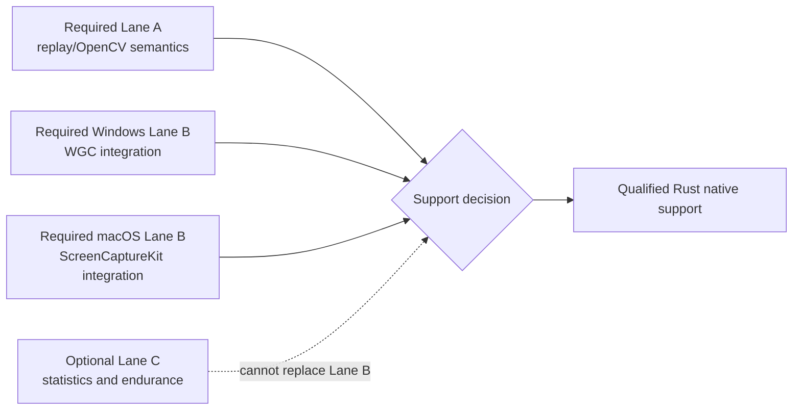
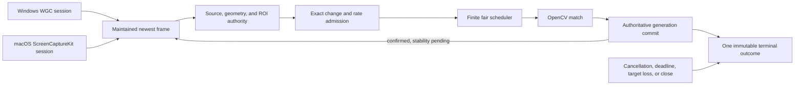

# Native template watching from Rust

MadoPilot can wait for stable template presence on maintained Windows Graphics
Capture (`WGC`) or macOS `ScreenCaptureKit` sessions through the Rust facade
(`Session::start_template_watch`). Callers start one bounded query and receive
one immutable terminal outcome without writing a frame-polling loop, activating
targets, injecting input, or prompting for permissions.

Native support on both release targets rests on the token-driven Qualification V2
contract below: Apple Silicon source `318ad1c` passed the required `Lane B`
contract on macOS `26.6.2` (SDK `26.5`), Windows source `3e3079f` passed the
required `Lane B` contract on the mixed-DPI Windows 11 25H2 host, and test-only
successor `53608af` pins the earlier-deadline clamp across both targets through
reviewed target-isolated applicability.

## Current boundary

| Surface | State |
|---|---|
| Rust `Session::start_template_watch` over replay/OpenCV | Supported |
| Rust `Session::start_template_watch` over Windows WGC window/display sessions | Supported on the qualified Windows 11 25H2 floor (`3e3079f` passed all 8 semantic/cleanup scenarios on the mixed-DPI host; `53608af` pins the earlier caller deadline) |
| Rust `Session::start_template_watch` over macOS ScreenCaptureKit window/display sessions | Supported on the qualified macOS 26.5.2 floor (`318ad1c` passed all 8 semantic/cleanup scenarios on Apple M1 Pro macOS 26.6.2, carried through `53608af`) |
| `TemplateQuery::poll`, `wait`, `cancel`, and immutable terminal results | Supported for replay/OpenCV and qualified native sessions |
| OCR predicates inside template queries | Not implemented; use [OCR text queries](ocr-text-watch.md) to wait for literal text |
| Watcher callbacks, subscriptions, Tokio/futures, automatic input, or C/C++ watcher APIs | Not implemented (C ABI 1.5 remains unchanged) |

Revision-bound Qualification V2 report identities:

- **Apple (`aarch64-apple-darwin`):** Commit `318ad1c49102d9fcd33448d12ee75d739bf04336`,
  tree `00fe097cb4b1ea4eaf58abc87f496584f50d3ae8`, runner SHA-256 `7a4720f3ca8b756b0f2757988921c901983a13ef6e67fd86926860e3d5e6ea87`,
  fixture SHA-256 `d7fe848cccaf2db829dafd538b36460d1c015d33d666ac4158e015d4e700e307`,
  codec SHA-256 `8b59a9cbc375e21ca39514a6c2f2ca16ebdaec47b82126d7c7d36c7809dc8f10`,
  report SHA-256 `9518c00ec118b1e2f21027fd1c7bd811a3f176f79ef89752714ef27c65ce6289`.
- **Windows (`x86_64-pc-windows-msvc`):** Commit `3e3079f2d71243d1b25d5bda79e3672c0cd3df07`,
  tree `77f127c281e35b4475cb5e931ae10b969b6f1a64`, runner SHA-256 `bd827d1be2114145a1f7c436ef70adbe0a6047d4e1e1f5bfdfcbc66bcf92b714`,
  fixture SHA-256 `5a50466c3fbf420df3d56ae466a6ae233254705f340098bca677a574ae9e8957`,
  codec SHA-256 `8b59a9cbc375e21ca39514a6c2f2ca16ebdaec47b82126d7c7d36c7809dc8f10`,
  report SHA-256 `a4b6800217f1f96872d7f25f0614c1ff2a3a6f1942293267f990193557a92fbe`.
  Earlier V1 passes and repairs are summarized under
  [earlier qualification attempts](#earlier-qualification-attempts).

## Qualification V2 protocol and migration



- **Required `Lane A` (deterministic replay/OpenCV):** Runs via
  `cargo bench --locked --package mado-pilot --bench template-watch-query` in
  hosted CI on both targets, enforcing scheduler deadlines, stability,
  change/rate admission, coalescing, saturation, fairness, stale-generation
  rejection, diagnostics, and bounded allocation growth.
- **Required `Lane B` (compact native contract on Windows WGC and macOS
  ScreenCaptureKit):** Built with `--features native-template-watch-qualification`
  and invoked once per approved host with `--native-contract` (schema
  `mado-pilot.native-template-watch-contract.v2`; exit `0` = `PASS`, `1` =
  product `FAIL`, `2` = `INFRA`, `3` = `UNSUPPORTED`). Exercises 8 compact
  scenarios driven by an acknowledged 10×9 visual token grid outside the
  template ROI (asymmetric sentinels, 32 token bits + inverse, marker bit, 5-bit
  checksum):
  1. Target and non-prompting permission admission.
  2. Post-open absent-token synchronization (startup interval).
  3. Correlated watcher match after visible-token acknowledgement (watch interval).
  4. Fair two-session progress.
  5. Geometry generation across target changes.
  6. Retained native frame and CPU-mapping ownership alongside fresh-session progress.
  7. Exact session, engine, and target termination (`TargetLost`).
  8. Explicit native and fixture teardown to resource baseline (Windows process
     reap + reader join; macOS authenticated launch `Live` -> `Stop` -> `Lost`,
     containment, output drain, and zero cleanup debt).
- **Optional `Lane C` (`--lane-c-evidence`, optionally `--enforce-budgets`):**
  Collects statistical latency, topology, resource, and 24-workload endurance
  evidence without replacing `Lane B`.

## Prerequisites

- Build with the pinned Rust toolchain and host OpenCV 4 installation via
  `tools/setup-native.py` (see [native development prerequisites](../CONTRIBUTING.md#native-development-prerequisites)).
  Production callers do not enable `native-template-watch-qualification`.
- Minimum deployment floors: Windows 11 25H2 build `26200` (`x86_64-pc-windows-msvc`)
  and Apple Silicon macOS `26.5.2` (`aarch64-apple-darwin`).
- On macOS, grant **Screen Recording** to the host process before opening capture
  (Accessibility/event-post access is not required for watching). On Windows, idle
  frame acquisitions recheck raw native key liveness at 100 ms intervals derived
  from the caller's clock so vanished targets report `TargetLost` promptly.
- Callers supply a validated asset package, prepared template, `MatchOptions`,
  `TargetId` from the current discovery snapshot, `TemplateAnalysisRate`,
  `TemplateStability`, `ChangeDetectionPolicy`, and query/wait
  `OperationContext` instances.

## Rust flow

Run [`crates/mado-pilot/examples/native-template-watch.rs`](../crates/mado-pilot/examples/native-template-watch.rs)
against a discovered target index:

```text
cargo run --locked --package mado-pilot --example native-template-watch -- \
  <asset-package-directory> <template-name> <target-index>
```



`TemplateWatchRequest` owns query lifetime authority; `TemplateQuery::wait` uses
an independent caller-wait `OperationContext` whose timeout/cancellation ends
only that wait. `TemplateQuery::cancel` (or dropping the handle) cancels the
query idempotently. Terminal outcomes are `Matched` (retaining the exact frame,
transform, effective ROI, match result, and confirmed count independently of
session teardown), `Cancelled`, `DeadlineExceeded`, `SessionClosed`,
`SchedulerClosed`, `TargetLost`, `Overloaded(QueueExpired)`, or `Failed`.

## Scheduling and performance

See [Bounded template-presence queries](architecture.md#bounded-template-presence-queries)
for the fixed scheduler limits (`256` queries/engine, `16` sessions, `64`
queries/session, `2` analysis slots, `64 MiB`/`256`-entry ROI mapping cache, and
`30 s` eligible queue residence). Capture publication never blocks on OpenCV
matching, and displaced or expired work is observable in query outcomes and
diagnostics.

### Earlier qualification attempts

Historical V1 qualification attempts remain bound to their original commits and
do not affect the V2 support decision above:

- `f16591f`: Windows passed 5 fresh processes; Apple passed processes 1–4 and
  failed process 5 at `retained_result_mapping` after ScreenCaptureKit stream
  suspension.
- `030398e`: Failed `retained_result_mapping` fixture finalization and latency
  ceilings, motivating the retained-lifetime and typed-finalization repair.
- `9cf746f`: Terminated at pre-process-1 apparatus controls without retry.
- Historical ADRs `0053`, `0057`, and `0059`–`0064` remain browsable at commit
  [`646369fad6c922ac7b064367817337a18e572d8c`](https://github.com/pashifika/mado-pilot/tree/646369fad6c922ac7b064367817337a18e572d8c/docs/adr).

## Diagnostics and privacy

Engine diagnostics default to `Off` and exclude pixels, hashes, template names or
bytes, window titles, native identifiers, paths, and desktop metadata when
enabled at `Normal` or `Debug` (see
[Bounded diagnostic observation](architecture.md#bounded-diagnostic-observation)).
Tracked V2 `Lane B` reports (`<= 64 KiB` JSON) additionally pass a two-stage
validator in `mado-pilot-testkit`: strict schema/privacy validation (rejecting
unknown fields, paths, titles, pixels, or free-form text) followed by host
environment compatibility validation (`windows-i7-12700kf-32g` on Windows 11 Pro
25H2 build `26200` / SDK `10.0.26100.0`, and the Apple M1 Pro allowlist).

## Troubleshooting

- **macOS refuses discovery or open:** Grant Screen Recording to the host app in
  System Settings and restart it.
- **Discovery returns no usable target:** Run a fresh discovery pass after the
  target window opens; never reuse a `TargetId` from an older target lifetime or
  another engine.
- **`DeadlineExceeded` vs caller wait timeout:** Inspect the query's terminal
  outcome, as `wait` timeouts end only that wait call.
- **`Overloaded(QueueExpired)`:** Eligible work waited more than `30 s` for an
  analysis slot; reduce capture/analysis rate, shrink the ROI, or adjust the
  deadline.
- **`TargetLost`, `SessionClosed`, or `SchedulerClosed`:** Open a new discovery,
  session, and query chain after the target is available again.

## Explicit limitations

Qualification covers the Rust `Session::start_template_watch` workflow over
replay/OpenCV, Windows WGC, and macOS ScreenCaptureKit on the supported OS
floors. It does not include OCR predicates, callbacks, async futures, C/C++
watcher APIs, automatic input, or installable binary packages.
