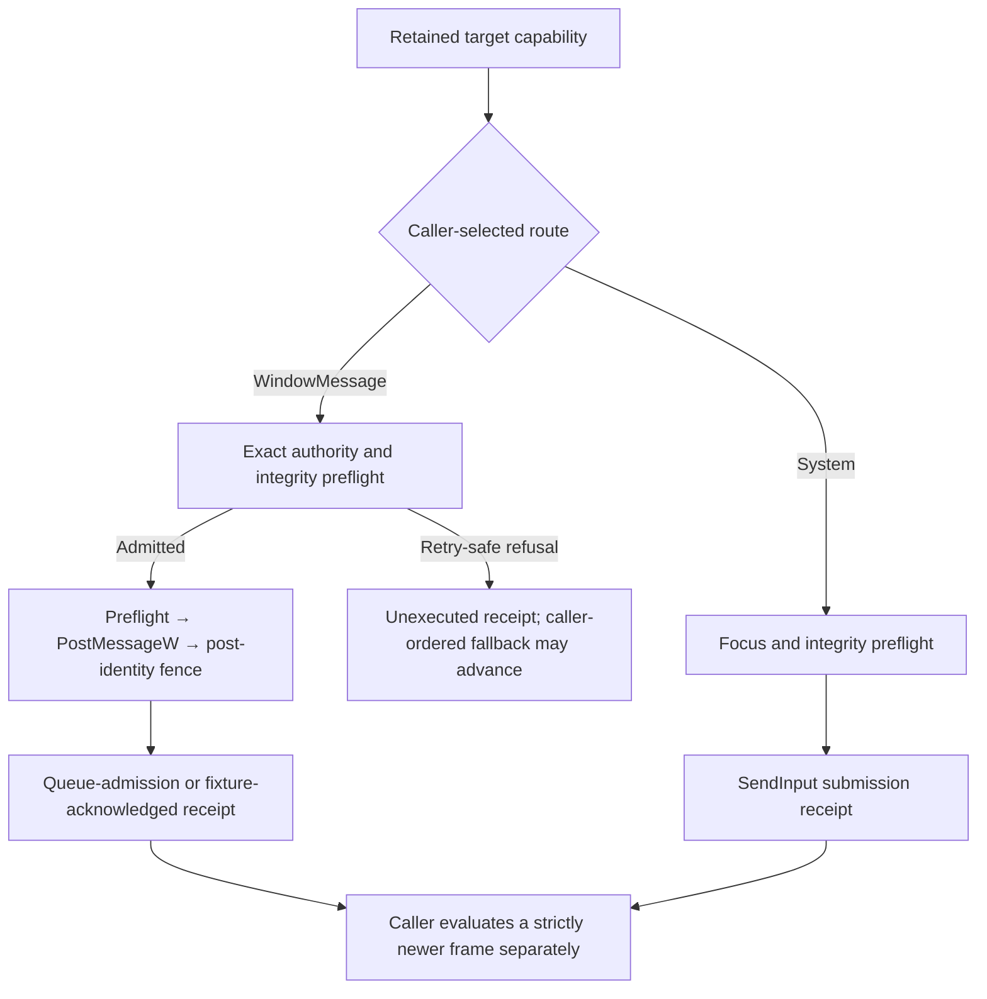

# Windows Input Adapter and Verification

`mado-pilot-platform-windows` implements Windows input at the adapter boundary,
wired into the public Rust facade via `mado_pilot::windows_engine` and exposed to
C and C++ through C ABI 1.5 (`madopilot.h` / `MadoPilot::C`).

**Shared verification preconditions across all Windows input checks:**

- **Ordinary `cargo test` sends no `System` input:** It starts only
  `MadoPilotInputFixture` in no-activation mode; interactive `System` and
  `WindowMessage` native matrices are `--ignored` and require explicit opt-in on
  an unlocked desktop.
- **No implicit fallback, queue attachment, or elevation:** `System` is never
  substituted for `WindowMessage` unless ordered in `DeliveryPlan` after a
  zero-effect preflight refusal. Production code never calls `AttachThreadInput`,
  `BlockInput`, or privilege elevation.
- **Separate submission and visual evidence:** `SystemInputAdmission`,
  `TargetQueueAdmission`, and `TargetProtocolAcknowledgement` record native API
  or fixture-protocol acceptance; callers evaluate visual changes on strictly
  newer frames.

## Capability boundary

| Discovered target | `System` (`SendInput`) | `WindowMessage` (`PostMessageW`) |
|---|---|---|
| Retained ordinary top-level window | Pointer, keyboard, text; `Supported`; focus required; `SystemInputAdmission` | Pointer, keyboard, text; `Unknown`; exact-window, focus-preserving; `TargetQueueAdmission` |
| Exact class `MadoPilotInputFixture` | Pointer, keyboard, text; `Supported`; focus required; `SystemInputAdmission` | Pointer, keyboard, text; `Supported`; exact-window, focus-preserving; `TargetProtocolAcknowledgement` |
| Display | Pointer only; no focus requirement | Unsupported |
| Child, lost, replaced, or unrevalidatable window | Not admitted | Unsupported or refused before posting |



Ordinary `WindowMessage` compatibility is `Unknown` because legacy-message
consumers observe `WM_*` messages while Raw Input (`WM_INPUT`), DirectInput,
XInput, and async state-polling consumers do not.

### Exact target authority

Immediately before and after every normal or cleanup `PostMessageW`, the adapter
revalidates the retained `HWND`, owner process creation `FILETIME`, owning
thread, root relationship, window class, provider identity, capture-item
liveness, operation deadline/cancellation, integrity level, and required
geometry. If authority changes after an accepted post, the sequence settles as
`Partial` (possible native effect) and closes fallback. Because Win32 provides
no generation-atomic compare-and-post API, same-value `HWND` recycling during
the immediate call interval remains a documented OS limitation.

### Ordinary message profile

Ordinary delivery uses asynchronous `PostMessageW` only:

| Logical event | Native message profile | Native units and bounds |
|---|---|---|
| Pointer move | `WM_MOUSEMOVE` with signed 16-bit client coordinates and `MK_*` state | 1 unit |
| Primary/secondary/middle button down/up | Unconditional positioning `WM_MOUSEMOVE` followed by `WM_*BUTTONDOWN/UP` | 2 units (requires prior pointer position) |
| Vertical/horizontal scroll | `WM_MOUSEWHEEL` then `WM_MOUSEHWHEEL` with signed screen coordinates, `WHEEL_DELTA` multiples, and `MK_*` state | 0–2 units in order (requires prior pointer position) |
| Key down/up | `WM_KEYDOWN` / `WM_KEYUP` with target-layout virtual key, scan code, extended, previous-state, and transition bits | 1 unit |
| Text | Direct `WM_CHAR` UTF-16 units (no `TranslateMessage` dependency) | `1..=8,192` units (`<= 4,096` scalars) |
| Delay | Bounded wait with operation context checks | 0 units |

All five pointer coordinate spaces are supported (`ReprojectCurrent`,
`RequireUnchanged`, and `UseFrameSnapshot` over the live stream geometry ledger).
Physical desktop metrics and `GetPhysicalCursorPos` run under a checked
thread-local Per-Monitor v2 (`PMv2`) scope, while `WindowMessage` converts
physical points into the target's logical screen/client convention and posts
under the target's DPI context, restoring the caller's thread DPI state on every
exit. Coordinates outside signed `i16` are refused without clamping.

## Focus, integrity, receipts, and cleanup

- **System focus and PMv2 scope:** `System` absolute pointer moves invoke
  `SendInput` inside a scoped `PMv2` context and restore caller DPI state on
  return. `System` window targets revalidate foreground focus before each event
  (`ActivateIfRequired` makes one `SetForegroundWindow` attempt and re-reads
  foreground; `WindowMessage` never changes focus or moves the physical cursor).
- **UIPI and error mapping:** Proven higher-integrity targets fail preflight with
  `PolicyRefused`. A zero `SendInput` return without proven UIPI reports
  `DeliveryFailed`. On `PostMessageW`, access denial maps to `PolicyRefused`,
  invalid window to `TargetLost`, and queue quota/other errors to
  `SubmissionFailed`.
- **Sequence-owned cleanup and odd UTF-16 text prefixes:** Pressed keys and
  buttons are released newest-first on the same route within `CleanupBudget`
  (`256` events, `250 ms`). If a `System` UTF-16 text submission stops after an
  unmatched key-down unit, that pending Unicode key-up is released first under
  the shared cleanup budget and counted in the receipt's aggregate `released` /
  `owed` fields without altering the original fault or authorizing a retry.

## Repository-owned fixtures

- `mado-pilot-windows-window-message-fixture`: Creates ordinary top-level windows
  (`MadoPilot Ordinary WindowMessage Fixture [<token>]`) modeling legacy,
  game-like, Raw Input, async state-polling, sibling/child/replacement, queue
  pressure, and bounded repaint modes (`TargetQueueAdmission`).
- `mado-pilot-windows-input-fixture`: Creates the acknowledged window (class
  `MadoPilotInputFixture`, title `MadoPilot Input Fixture [<pid>]`) with a
  size-bounded `WM_COPYDATA` control channel and 1,024-event summary recorder
  reporting only event kinds and UTF-16 unit counts (`TargetProtocolAcknowledgement`).

## Windows checks

Run the non-interactive test suite from the repository root (using the Windows
`tools/setup-native.py` wrapper in [CONTRIBUTING.md](../CONTRIBUTING.md#native-development-prerequisites)
when building workspace targets):

```sh
cargo check --locked -p mado-pilot-platform-windows --all-targets
cargo test --locked -p mado-pilot-input
cargo test --locked -p mado-pilot-platform-windows --lib
cargo test --locked -p mado-pilot-platform-windows --test native_input
```

On an unlocked interactive desktop, run the ordinary `WindowMessage` native
matrix (which keeps an unrelated owned fixture in the foreground):

```sh
cargo test --locked -p mado-pilot-platform-windows --test window_message_native ordinary_window_message_native_matrix -- --ignored --exact --nocapture --test-threads=1
```

## Explicit system-input check

Run on an interactive Windows desktop and click the PID-qualified fixture within
the 15-second prompt (moves the pointer to the fixture center, sends Enter
down/up and `system-probe` with no click, and restores cursor/foreground on
exit):

```sh
cargo test --locked -p mado-pilot-platform-windows --test native_input interactive_system_delivery_targets_only_the_exact_fixture -- --ignored --exact --nocapture --test-threads=1
```

## Explicit facade check

Exercises `mado_pilot::windows_engine` (`WindowMessage` route with focus
preservation, `TargetQueueAdmission` receipt inspection, and strictly newer
frame verification while a second owned fixture remains frontmost):

```sh
cargo run --locked --package mado-pilot-platform-windows --bin mado-pilot-windows-window-message-fixture -- --title-token=example
cargo run --locked --package mado-pilot --example windows-native-input -- "MadoPilot Ordinary WindowMessage Fixture [example]"
```

## Explicit C ABI boundary checks

Non-input C ABI check (`--check`, default):

```bat
cargo run --locked --package mado-pilot-capi --example c-abi-check -- --label "<host>"
```

To run the full C default (4-event) and `--extended-sequence` (16-event)
`WindowMessage` flows against fresh ordinary and acknowledged fixtures:

```bat
cargo build --locked --package mado-pilot-platform-windows --bin mado-pilot-windows-input-fixture --bin mado-pilot-windows-window-message-fixture
cargo build --locked --package mado-pilot-capi
cargo run --locked --package mado-pilot-capi --example c-abi-check -- --label "<host>" --windows-native-fixture
```

When managing fixture lifecycles externally, pass `--ordinary "<full title>"` or
`--acknowledged "<full title>"` (optionally prefixed with `--extended-sequence`)
to `windows-native-input.exe`.

## Audit 2, 6 and 16 acceptance

Keep ordinary, `private-fixture`, and qualification Cargo target directories
separate (`CARGO_TARGET_DIR`) and bind exact source/artifact digests before each
run.

### Non-input checks

Deterministic unit, cleanup-seam, and UTF-16 argument-conversion checks:

```text
cargo test --locked -p mado-pilot-platform-windows --lib input
cargo test --locked -p mado-pilot-platform-windows --lib window_message::tests
cargo test --locked -p mado-pilot-platform-windows --test window_message_native dpi_selectors_accept_only_declared_modes
cargo clippy --locked -p mado-pilot-platform-windows --all-targets -- -D warnings
cargo run --locked -p mado-pilot-capi --example c-abi-check -- --windows-ingress-only
```

Read-only interactive DPI cursor and snapshot checks (keep the physical cursor
stationary; sends no input):

```text
cargo test --locked -p mado-pilot-platform-windows --lib native_input::tests::coordinates::native_non_move_cursor_preserves_physical_coordinates_and_caller_dpi -- --ignored --exact --nocapture
cargo test --locked -p mado-pilot-platform-windows --test window_message_native desktop_snapshots_preserve_physical_coordinates_and_caller_dpi -- --ignored --exact --nocapture
```

### Owned-fixture DPI arrival

Set `MADO_PILOT_WINDOWS_DPI_INPUT=1`,
`MADO_PILOT_WINDOWS_DPI_TOPOLOGY=<single-display|mixed-dpi-signed>`, and
`MADO_PILOT_WINDOWS_DPI_MONITORS="left,top,right,bottom,dpi_x,dpi_y;..."`
(optional `MADO_PILOT_WINDOWS_DPI_CALLER` and `MADO_PILOT_WINDOWS_DPI_TARGET`
filter `unaware`, `system`, or `per-monitor-v2`; operations bounded at 5 s,
close at 2 s, restoration at 500 ms):

```text
cargo test --locked -p mado-pilot-platform-windows --test window_message_native dpi_system_arrival_matrix -- --ignored --exact --nocapture --test-threads=1
cargo test --locked -p mado-pilot-platform-windows --test window_message_native dpi_window_message_arrival_matrix -- --ignored --exact --nocapture --test-threads=1
```

### Focused ordinary input

With `MADO_PILOT_WINDOWS_ORDINARY_INPUT=1`, run one ignored selector at a time:

| Selector | Required observation |
|---|---|
| `ordinary_window_message_input_acceptance` | Paired modifier/function-key and supplementary UTF-16 text delivery; preserved foreground, cursor, and physical keys; no `System` fallback |
| `ordinary_system_input_acceptance` | Delivery to the owned focused target with modifiers/function key released before and after |
| `ordinary_focus_fallback_acceptance` | Unfocused `System` and ordered `System`/`WindowMessage` requests refuse before submission |
| `ordinary_uipi_acceptance` | Lower-integrity owned sender refuses higher-integrity owned target with `PolicyRefused` before submission |

### Actual non-ASCII C consumers

On an approved non-UTF-8-ACP host (e.g., ACP `932`), build `mado-pilot-capi` and
`c-abi-check` with `private-fixture` in a dedicated target root, set
`MADO_PILOT_G004_MODEL_ROOT` and `MADO_PILOT_ONNX_RUNTIME`, and run
`c-abi-check --windows-path-acceptance` to verify Japanese and
supplementary-character paths across package, default/profile/private OCR, and
C-only CMake consumers (direct consumers bounded to 90 s + 5 s teardown, CTest
rows to 60 s, copied trees to 512 entries / 2 GiB / depth 16; exit `77` is a
prerequisite skip, not acceptance).

## Native evidence and limitations

Revision-bound Windows 11 Pro `26200` runs at commit `223925d` passed the
complete `WindowMessage` matrix, Rust and C/C++/CMake ABI 1.2 flows, frozen ABI
1.0 compatibility, and the 50-sample native input performance profile, plus
supplemental rows:

- **Single-display (`144x144` DPI), mixed-DPI (`144x144` + `96x96`), and same-DPI
  negative-X (`H-02`, two `144x144` monitors):** Rejected stale source-frame
  geometry after movement and accepted correlated pointer/wheel requests while
  preserving foreground and physical cursor.
- **Higher-integrity UIPI refusal (`H-07`):** Medium-integrity C ABI caller (RID
  `0x2000`) targeting an operator-elevated high-integrity fixture (RID `0x3000`)
  returned `Unexecuted`, `0` submitted, and `PolicyRefused` with no cleanup owed.
- **Audit 2/6/16 repairs:** Mixed-DPI arrival and ACP `932` package/OCR consumers
  passed at the revisions recorded in [v0.5.0 release notes](releases/v0.5.0.md#windows-audit-repairs).
- **Documented boundaries:** A 4,096-attempt `HWND`-reuse stress pass observed no
  recurrence but does not prove generation-atomic Win32 handle safety, and
  `Unknown` ordinary compatibility does not claim support for Raw Input,
  DirectInput, XInput, or anti-cheat targets.

## Redaction review

Production input and diagnostic records exclude event payloads, keys, text,
window titles, native handles, paths, and captured pixels (see
[Bounded diagnostic observation](architecture.md#bounded-diagnostic-observation)).
Native verification evidence records only fixture roles, bounded counts/statuses,
host/topology metadata, commands, and source/executable digests.
