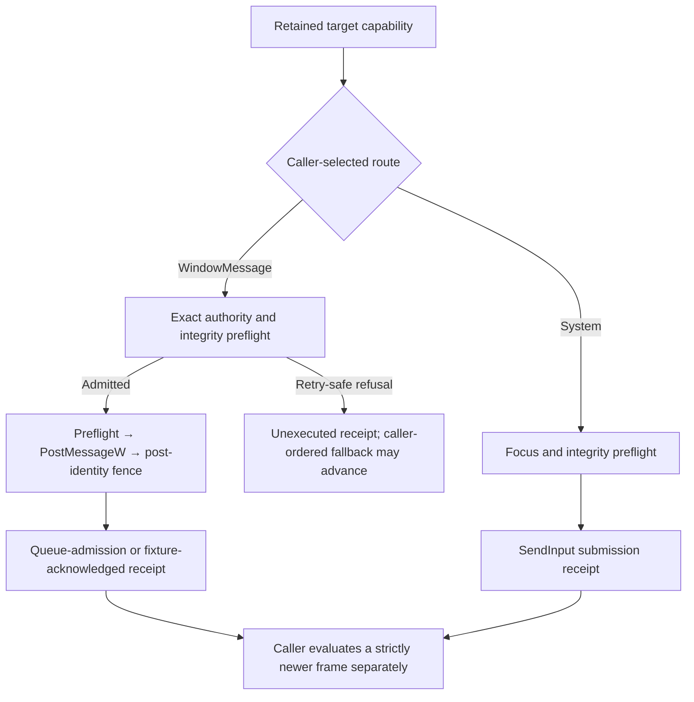

# Windows Input Adapter and Verification

The Windows platform package implements input at the Adapter boundary.
`mado_pilot::windows_engine` wires it into the public Rust facade. C and C++
consume that workflow directly through C ABI 1.5's preserved input entries.
`System` and `WindowMessage` remain separate caller-selected routes. Ordinary retained
top-level windows expose `WindowMessage` as unknown-but-attemptable with
target-queue evidence; only the dedicated acknowledged fixture raises that
evidence to target-protocol acknowledgement. Neither receipt proves application
consumption or visual effect.

## Capability boundary

Capabilities are operation-and-route pairs. Address scope, compatibility, and
submission evidence are independent fields; a target never acquires an
exact-window capability merely because it accepts the same operation through
system input.

| Discovered target | `System` | `WindowMessage` |
|---|---|---|
| Retained ordinary top-level window | Pointer, keyboard, text; supported; focus required | Pointer, keyboard, text; `Unknown`; exact-window, focus-preserving, target-queue-admission evidence |
| Exact class `MadoPilotInputFixture` | Pointer, keyboard, text; supported; focus required | Pointer, keyboard, text; `Supported`; exact-window, focus-preserving, target-protocol acknowledgement |
| Display | Pointer only; no focusable target is implied | Unsupported |
| Child, lost, replaced, or unrevalidatable window | Not admitted as a retained top-level target | Unsupported or refused before posting |

The caller explicitly selects or orders routes. There is no default
`WindowMessage` choice and no implicit fallback to `System`:



[ADR 0022](adr/0022-windows-ordinary-background-input-qualification.md)
remains the evidence for the stronger claim it tested. Its ordinary/game-like
consumers observed legacy messages, while Raw Input and asynchronous
state-polling consumers did not; queue admission and a generic procedure return
could not establish application consumption. [ADR 0027](adr/0027-windows-window-message-queue-submission.md)
therefore supersedes only ADR 0022's system-only consequence. The current
contract reports ordinary compatibility as `Unknown`, caps evidence at
`TargetQueueAdmission`, and requires a separate newer-frame observation when a
caller needs effect evidence. It makes no Raw Input, DirectInput, XInput,
asynchronous-state, raw-HID, helper, hook, anti-cheat, or arbitrary-game claim.

### Exact target authority

Immediately before and after every normal or cleanup `PostMessageW`, the Adapter
checks the retained `HWND`, owner process creation identity, owning thread, root
relationship, class, provider identity, capture-item liveness, operation bound,
integrity, and required geometry. Mutable title and geometry never grant target
authority. A failed preflight posts nothing. An accepted post followed by changed
or unavailable authority is a possible native effect and stops the sequence.

This fence is intentionally not described as atomic. Win32 has no
generation-bearing compare-and-post API, and a foreign window can be destroyed
and its same-value handle recycled between validation and `PostMessageW`.
Bounded reuse stress can detect a recurrence in that run but cannot prove the
race absent.

### Ordinary message profile

Ordinary delivery uses asynchronous `PostMessageW` only:

| Logical event | Native profile | Native units and bounds |
|---|---|---|
| Pointer move | `WM_MOUSEMOVE`; signed client coordinates and current `MK_*` state | One unit |
| Primary/secondary/middle button down/up | Unconditional positioning `WM_MOUSEMOVE`, then matching `WM_*BUTTONDOWN/UP` | Exactly two units; requires a previously established pointer position |
| Vertical/horizontal scroll | `WM_MOUSEWHEEL`, then `WM_MOUSEHWHEEL`; signed screen coordinates, checked `WHEEL_DELTA` multiples and `MK_*` state | Zero to two units in that order; requires a previously established pointer position |
| Key down/up | `WM_KEYDOWN/WM_KEYUP`; target-layout virtual key and scan code, extended, previous-state, and transition bits | One unit |
| Text | Ordered direct `WM_CHAR` UTF-16; no `TranslateMessage` dependency | `1..=8192` units for at most 4,096 public scalars |
| Delay | Bounded wait with operation checks | Zero units |

The public input vocabulary contains only primary, secondary, and middle
buttons, so there is no X-button translation. Every packed client or screen
coordinate must fit signed `i16`; the Adapter refuses an unrepresentable event
instead of truncating, wrapping, or clamping it. A combined scroll posts vertical
before horizontal, and failure after the first component is partial.

All five shared pointer spaces are advertised because Windows capture publishes
an authoritative target placement. `ReprojectCurrent` reads current extent,
placement, and scale. `RequireUnchanged` compares the retained source transform
with current authority. `UseFrameSnapshot` requires that exact stream, epoch, and
geometry revision to remain retained; the Adapter does not reconstruct an
evicted revision from current DPI.

Physical desktop metrics use a checked, thread-local PMv2 scope; current-cursor
queries use `GetPhysicalCursorPos`. Message coordinates are converted into the
target's logical screen convention, then into client coordinates where required.
Pointer messages are also posted under the target's DPI context, preventing
USER32 from scaling the prepared coordinates again from the caller's context.
Every temporary DPI scope restores the caller's context. Failed scope entry or
conversion refuses the event without changing process DPI or input authority.

The route never synthesizes `WM_INPUT`, mutates global asynchronous key state,
activates the target, moves the physical cursor, calls `SendInput`,
`SendMessageTimeoutW`, or `BlockInput`, attaches queues, changes message filters,
broadcasts, installs hooks, injects a helper, or elevates.

## Focus, integrity, receipts, and cleanup

Window `System` input revalidates focus before every irreversible event.
`Preserve` cannot satisfy a focus-requiring system path. `RequireFocused` never
activates a window. `ActivateIfRequired` makes one ordinary
[`SetForegroundWindow`](https://learn.microsoft.com/en-us/windows/win32/api/winuser/nf-winuser-setforegroundwindow)
attempt and then re-reads the foreground window; Windows may refuse it under its
foreground-lock rules. `WindowMessage` instead invokes neither focus activation
nor physical-cursor mutation APIs. External input or the target's own message
handling can still change global state, so a receipt does not certify immutable
foreground/cursor values; controlled native rows assert unchanged observations
as a separate fixture oracle.

Before either route submits input, the Adapter compares the caller and selected
window process integrity levels. A proven higher target reports
`PolicyRefused`. When
[`SendInput`](https://learn.microsoft.com/en-us/windows/win32/api/winuser/nf-winuser-sendinput)
returns zero and integrity inspection does not prove UIPI, the system route
reports `DeliveryFailed`; it does not infer UIPI from last error. For
`PostMessageW`, access denial maps to `PolicyRefused`, an invalid window to
`TargetLost`, and queue quota or another posting failure to
`SubmissionFailed`.

`submitted` counts complete logical events admitted to the selected native
route. System `SendInput` yields `SystemInputAdmission`; ordinary
`WindowMessage` yields `TargetQueueAdmission`; the dedicated fixture yields
`TargetProtocolAcknowledgement`. These remain submission facts. A complete
ordinary receipt may coexist with no consumer or visual change.

Once a route enters event submission, fallback closes even if the first
`PostMessageW` accepts no unit. A partial native representation, any accepted
unit followed by failure, or an indeterminate post-identity fence is `Partial`
with possible effect; it is never retry-safe `Unexecuted`. Only a separately
reported preflight refusal may let an explicitly ordered fallback advance.

Pressed buttons and keys belong only to the sequence that successfully posted
their complete press representation. On a stop, cleanup releases them newest
first through the same route and retained authority. It admits no more than 256
release events and starts no new release after 250 milliseconds. Cleanup cannot
switch to `System`, revive a lost target, or turn queue admission into proof of
application state.

An odd accepted System text prefix owes one Unicode key-up. That private state
is released before earlier sequence-owned keys/buttons, using the controller's
single event allowance and fresh cleanup deadline. Zero allowance sends nothing;
a failed release stops cleanup. `Complete`, `Incomplete`, and `Exhausted` report
aggregate owed/released counts without changing the original fault or complete
logical-event prefix. Cancellation never authorizes text retry or fallback.

## Repository-owned fixtures

`mado-pilot-windows-window-message-fixture` creates ordinary top-level windows
through the production discovery class path. Its default title is
`MadoPilot Ordinary WindowMessage Fixture [<token>]`. Controlled modes model
ordinary and game-like legacy consumers, Raw Input, asynchronous state polling,
duplicate descriptive metadata, sibling/child/reparent/replacement/restarted
ownership, queue pressure, target loss, and bounded repaint. Its painted
condition is an observation oracle, not acknowledgement hidden in the receipt.

`mado-pilot-windows-input-fixture` creates the one acknowledged top-level window:

- class `MadoPilotInputFixture`;
- exact title `MadoPilot Input Fixture [<pid>]`;
- a versioned and size-bounded `WM_COPYDATA` vocabulary;
- synchronous acknowledgement for each accepted event; and
- at most 1,024 retained summaries containing only event kind and UTF-16 unit
  count.

The acknowledged fixture validates packet length, scalar fields, key and button
codes, and UTF-16. It neither retains nor prints input text. Both fixture kinds
are selected by exact title and retained target identity; zero or multiple
matches stop before input. Only the exact acknowledged class reports
`TargetProtocolAcknowledgement`.

## Windows checks

Run the non-interactive checks from the repository root:

```sh
cargo check --locked -p mado-pilot-platform-windows --all-targets
cargo test --locked -p mado-pilot-input
cargo test --locked -p mado-pilot-platform-windows --lib
cargo test --locked -p mado-pilot-platform-windows --test native_input
```

The ordinary native matrix requires an unlocked interactive desktop because it
temporarily activates a repository-owned foreground fixture. Run it explicitly:

```sh
cargo test --locked -p mado-pilot-platform-windows --test window_message_native ordinary_window_message_native_matrix -- --ignored --exact --nocapture --test-threads=1
```

The matrix runs the public production route against repository-owned legacy and
negative-consumer modes while an unrelated owned window remains foreground. It
fails on foreground, physical-cursor, sibling/child/replacement, or wrong-process
effects and records queue, consumer/visual, lifecycle, topology, and cleanup
observations separately. The acknowledged native test remains a distinct
protocol check. Deterministic suites cover capability admission, exact authority,
all message translations, immediate post errors, partial native effects,
fallback closure, cleanup, target loss, cancellation/deadline races, diagnostics,
and close.

## Explicit system-input check

The system path is ignored by the default suite because successful keyboard input
requires a real foreground window. Run it only on an interactive Windows desktop:

```sh
cargo test --locked -p mado-pilot-platform-windows --test native_input interactive_system_delivery_targets_only_the_exact_fixture -- --ignored --exact --nocapture --test-threads=1
```

The test opens the PID-qualified fixture and waits 15 seconds. Click that exact
fixture window when prompted. Only after it is foreground does the test use
`RequireFocused` to move the pointer to the fixture center, send Enter down/up, and
send the fixed text `system-probe`. It sends no click. A guard restores the previous
cursor position and foreground window on exit when Windows permits restoration.

If the fixture is not focused or target selection is ambiguous, the test stops
before system input. If focus changes after that authorization, integrity blocks
submission, or a native record count is short, execution fails with typed
submission evidence. Do not replace either failure with `AttachThreadInput`,
elevation, or input intended to defeat foreground policy.

## Explicit facade check

The Adapter tests above do not replace the public Rust composition path.
`crates/mado-pilot/examples/windows-native-input.rs` builds the Windows engine
with bounded diagnostics, selects one exact ordinary window, captures and maps a
source frame, requires the unknown-but-attemptable `WindowMessage` route, submits
one frame-bound sequence with focus preservation, inspects queue-admission
evidence, evaluates an expected condition only on a strictly newer frame, drains
diagnostics, and closes.

Start the ordinary target fixture, then pass its exact full title. The example
launches, activates, and monitors a second repository-owned fixture as the
unrelated foreground application:

```sh
cargo run --locked --package mado-pilot-platform-windows --bin mado-pilot-windows-window-message-fixture -- --title-token=example
cargo run --locked --package mado-pilot --example windows-native-input -- "MadoPilot Ordinary WindowMessage Fixture [example]"
```

The explicit foreground-fixture setup can use one balanced temporary input-queue
attachment before readiness when an unattended host's foreground lock rejects a
direct request. That setup ends before discovery or delivery and never activates
the input target. The input request never selects `System`, activation, elevation,
a helper, or a privileged identity. It refuses zero or multiple title matches.
Its receipt and newer-frame result are printed as independent facts; neither
titles, pixels, nor typed payloads enter diagnostics.

## Explicit C ABI boundary checks

The ABI checker runs the small direct C/C++ samples without native operations.
Its C native verifier uses `--check` by default: it creates the Windows engine,
checks the input/diagnostic surface and absence of a permission-probe capability,
then stops before discovery or input:

```bat
cargo run --locked --package mado-pilot-capi --example c-abi-check -- --label "<host>"
```

The unattended Windows matrix owns both fixture lifecycles. Build them first,
then let `c-abi-check` give the C default and extended flows separate fresh
ordinary/acknowledged fixtures and their exact titles:

```bat
cargo build --locked --package mado-pilot-platform-windows --bin mado-pilot-windows-input-fixture --bin mado-pilot-windows-window-message-fixture
cargo build --locked --package mado-pilot-capi
cargo run --locked --package mado-pilot-capi --example c-abi-check -- --label "<host>" --windows-native-fixture
```

The C default flow performs engine construction, discovery, capture, mapping, a
bounded four-event request, immutable receipt/attempt inspection, a strictly
newer expected-condition search, diagnostic drain and explicit close.
`--extended-sequence` performs the same lifecycle with sixteen events: pointer
movement, every button, both wheel axes, a function key, an ordered modifier
chord, Unicode text and an observed delay. `c-abi-check` verifies receipts,
newer expected-condition frames and the extended delay. The native-phase2
benchmark separately checks fixture-event order for the four-event default
flow; the extended flow's fixture-event order is not checked. The ordinary
flow requires `Unknown` capability and `TargetQueueAdmission`; the dedicated
flow requires `Supported` and
`TargetProtocolAcknowledgement`. Both preserve focus and permit no system
fallback. Frozen ABI 1.0/1.2/1.3/1.4 layouts and callers, direct C/C++ samples
and independent CMake consumers run in the same check.

When the caller owns a fixture lifecycle, pass `--ordinary "<full title>"` or
`--acknowledged "<full title>"` to `windows-native-input.exe`; prefix either with
`--extended-sequence` for the extended case. Output excludes the title, captured
bytes and typed text.

## Audit 2, 6 and 16 acceptance

The repairs have deterministic coverage; current-source physical arrival and
real non-ASCII package/OCR acceptance remain separate, unexecuted gates.
Historical rows below retain their original source and artifact bindings.

### Non-input checks

Use an x64 MSVC developer environment and the installed prerequisites from
[`CONTRIBUTING.md`](../CONTRIBUTING.md). Keep ordinary, private-fixture and
qualification build roots separate.

```text
cargo test --locked -p mado-pilot-platform-windows --lib input
cargo test --locked -p mado-pilot-platform-windows --lib window_message::tests
cargo test --locked -p mado-pilot-platform-windows --test window_message_native dpi_selectors_accept_only_declared_modes
cargo clippy --locked -p mado-pilot-platform-windows --all-targets -- -D warnings
cargo run --locked -p mado-pilot-capi --example c-abi-check -- --windows-ingress-only
```

The last command requires the separately built C library in the same output
root. It executes conversion/allocation/borrow-lifetime seams, not OCR or input.
Forced odd writes, failed releases and cancellation/deadline races use fake
native calls only. Do not reproduce stuck keys or short writes on a real desktop.

On a scaled interactive desktop, keep the cursor stationary for these read-only
checks. They verify physical cursor reads and caller-DPI restoration without
fixture activation or input; they do not prove arrival.

```text
cargo test --locked -p mado-pilot-platform-windows --lib native_input::tests::coordinates::native_non_move_cursor_preserves_physical_coordinates_and_caller_dpi -- --ignored --exact --nocapture
cargo test --locked -p mado-pilot-platform-windows --test window_message_native desktop_snapshots_preserve_physical_coordinates_and_caller_dpi -- --ignored --exact --nocapture
```

### Owned-fixture DPI arrival

Before execution, bind the integrated commit/tree, host/SDK, exact fixture and
test executables, loaded libraries, display topology and current input authority.
Set `MADO_PILOT_WINDOWS_DPI_INPUT=1` and
`MADO_PILOT_WINDOWS_DPI_TOPOLOGY=single-display` or `mixed-dpi-signed`.
Set `MADO_PILOT_WINDOWS_DPI_MONITORS` to the approved enumeration-order rows:
`left,top,right,bottom,dpi_x,dpi_y`, separated by `;`. Every physical bound and
effective DPI must match before the first fixture starts; count or DPI changes
refuse the run without input.
Optional `MADO_PILOT_WINDOWS_DPI_CALLER` and `MADO_PILOT_WINDOWS_DPI_TARGET`
accept `unaware`, `system` or `per-monitor-v2`; omission selects all three.

```text
cargo test --locked -p mado-pilot-platform-windows --test window_message_native dpi_system_arrival_matrix -- --ignored --exact --nocapture --test-threads=1
cargo test --locked -p mado-pilot-platform-windows --test window_message_native dpi_window_message_arrival_matrix -- --ignored --exact --nocapture --test-threads=1
```

The fixture supplies an independent physical/client/screen oracle before input.
Its chosen point must hit the target itself, not an overlapping owned child.
System tolerance is the virtual-desktop absolute-coordinate quantization bound;
client tolerance includes its measured target scale and one rounding pixel.
WindowMessage allows one logical rounding pixel. Never widen a failed row's
printed tolerance. Require actual target arrival, restored caller DPI state,
zero wrong-window observations and unchanged unrelated foreground/cursor for
WindowMessage. System also requires the independently observed physical cursor.
Fresh System button/wheel sequences exercise the physical current-cursor path;
ordinary WindowMessage retains its prior-sequence-position requirement.

Operations and arrival waits are bounded at five seconds. Input/capture close
use two seconds each, desktop restoration 500 ms, and fixture termination must
complete. Failed primary or teardown outcomes block acceptance. Missing topology
or authority leaves the row unexecuted.

### Actual non-ASCII C consumers

Windows samples use owned strict UTF-8 converted from `wmain` and, for the
profile sample, `_wgetenv`. Arguments override environment values; missing
prerequisites remain exit77, while malformed UTF-16/allocation failure is exit1.

On an approved non-UTF-8-ACP host, build the library and verifier with
`private-fixture` in their own output root. Supply the controlled model/runtime
environment variables, then explicitly select `c-abi-check --windows-path-acceptance`.
This mode creates Japanese/supplementary-character paths outside the observed
ACP, runs actual package/default/profile/private-OCR consumers, and checks the
C-only CMake profile with environment-only paths. No native input runs.

Before task6 execution, use a supervising controller with a declared whole-run
and cleanup deadline. The verifier bounds direct consumers to 90 seconds plus
five seconds for termination, CTest rows to 60 seconds, and copied trees to
512 entries/2 GiB/depth16; these are not a total CMake/build/deletion deadline.
Retain executable/DLL pre/post hashes, actual loaded-library identity, primary
and cleanup outcomes. Exit77, missing prerequisites or incomplete cleanup is
not acceptance. Do not change ACP, download dependencies or retry automatically.
The verifier attempts CMake build-tree cleanup after every returned outcome and
reports cleanup failures alongside the original configure/build/test result.

## Native evidence and limitations

The revision-bound Windows 11 Pro 26200 runs cover ordinary pointer, button,
wheel, key, text, delay, drag, and chord rows; duplicate metadata;
reparent/replacement/destroy/restarted ownership; negative Raw Input and
state-polling consumers; cancellation, deadline, cleanup, queue-full and partial
outcomes; a hung target; single-display, same-DPI, and mixed-DPI signed-origin
topology; unrelated foreground activity; facade visual/no-visual observations;
and medium-to-high-integrity refusal.

The supplemental single-display row used one physical monitor at effective DPI
`144x144`. It rejected stale source-frame geometry after the geometry revision
and accepted only the current correlated pointer/wheel request while preserving
foreground, cursor, and exact-target invariants.

The supplemental mixed-DPI row used two physical monitors at effective DPI
`144x144` and `96x96`. It rejected stale source-frame geometry after each
cross-monitor move and accepted only the current correlated pointer/wheel
request while preserving foreground, cursor, and exact-target invariants.

The supplemental same-DPI `H-02` row used two physical monitors at effective
DPI `144x144`. It crossed to the negative-X secondary, rejected stale
source-frame geometry after each move, and accepted only current correlated
pointer/wheel requests while preserving foreground, cursor, and exact-target
invariants.

The supplemental higher-integrity `H-07` row independently confirmed a
medium-integrity C ABI caller (RID `0x2000`) and high-integrity ordinary fixture
(RID `0x3000`). Production returned `Unexecuted`, zero submitted,
`PolicyRefused`, with no cleanup owed. The operator elevated only the target
fixture process; MadoPilot performed no elevation, message-filter change, or
fallback. The generic positive-flow verifier therefore exited `1`; that
nonzero exit plus the exact negative receipt is the row's expected result.

The same committed source `223925d` also passed both public-facade visual
oracles, the Rust example, the complete ABI 1.2 C/C++/CMake matrix, frozen ABI
1.0 compatibility, and the 50-sample native input/public-language performance
profile. Every measured workload satisfied its oracle and retained budget.

A bounded 4,096-attempt handle-reuse stress run observed no same-value
recurrence, which is not proof of generation-atomic safety. This remains an
explicit limitation, not an inferred pass. Unknown compatibility also remains
exactly that: evidence for one legacy consumer does not establish support for an
arbitrary game or another input family.

## Redaction review

Production input and diagnostic code emits no event payload, key, text, window
title, desktop content, captured bytes, native identifier, free-form native
message, platform namespace, path, signing identity, or backend name. It records
bounded public identities, route/scope/support, operation kinds and counts,
queue or protocol evidence, typed outcomes/faults, cleanup counts, and loss
counts.

The native verifier may retain only repository-fixture roles, bounded counts and
statuses, host/topology facts, commands, source/executable hashes, and hashes of
bounded raw output. It must not retain typed text, captured pixels, unrelated
window titles, or unrelated desktop payload. Fixture protocol observations,
queue admission, and visual search results remain separate columns so no report
can silently promote one into another.
